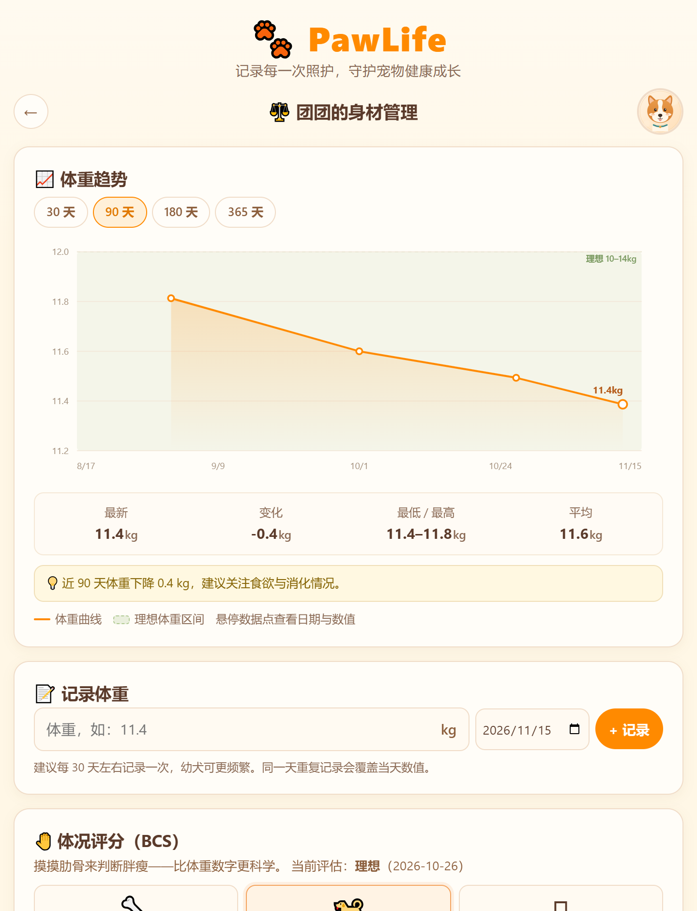
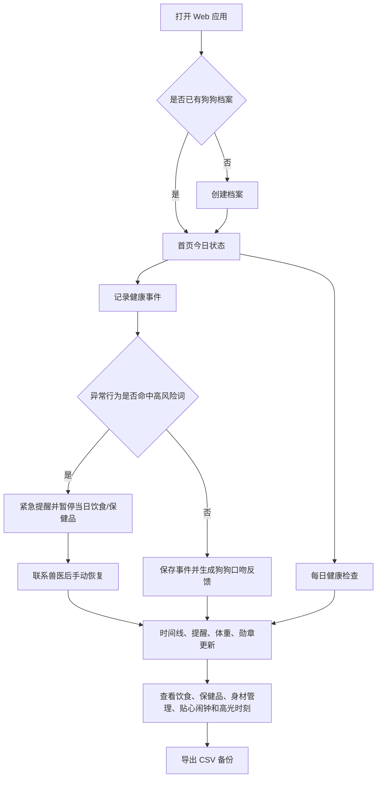
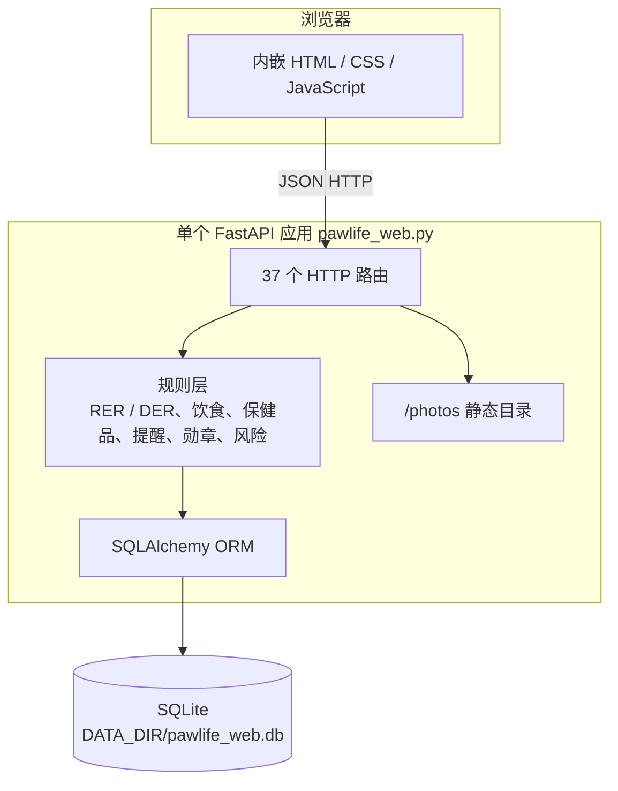
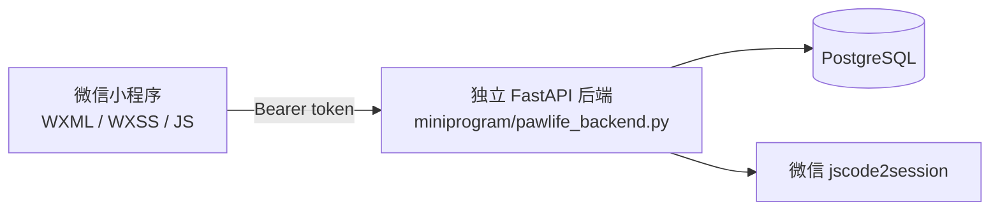

# PawLife | 狗狗健康管理与日常照护 Web 应用

## 1. 项目简介

PawLife 是一个面向养犬人的健康管理 Web 应用原型，围绕宠物档案、健康事件记录、饮食参考、体重与体况、日常提醒和轻量成长激励展开。应用采用狗狗第一人称的文案风格，希望降低新手主人在日常照护中的信息整理成本。

当前仓库包含三个部分：

- 原始 Web 应用：Python + FastAPI + SQLite 的单文件全栈应用，是项目的主要实现；
- 静态展示版 `showcase/`：不依赖 Python 后端的独立前端演示，用于浏览页面和交互；
- 微信小程序子项目 `miniprogram/`：独立的小程序前端及其 FastAPI + PostgreSQL 后端。

需要先说明边界：PawLife 输出的是基于规则的照护参考，不是兽医诊断，也不替代线下就诊。Web 端当前是单用户、单狗狗原型，没有账号体系和权限控制。

---

## 2. 项目展示

### 2.1 Showcase 静态展示版

仓库内的 `showcase/` 是一个独立的静态演示层，使用虚构演示狗狗「团团」和本地演示数据，不调用原始 Web 应用的 API，也不读写 SQLite 数据库。演示操作保存在浏览器 `localStorage` 中，清除站点数据后会恢复初始演示状态。

它包含 7 个页面：

- 首页：今日状态、每日健康检查、功能入口、健康档案摘要、成长记录；
- 成长日记：健康事件记录与时间线；
- 伙食搭配：食谱、营养计算依据、过敏源提示；
- 高光时刻：情绪卡、每日任务、勋章墙；
- 元气补给：保健品建议；
- 身材管理：体重趋势、体重记录、BCS 体况评估；
- 贴心闹钟：疫苗、驱虫、洗澡、体重、体况等提醒。

Showcase 的页面结构参考原始 Web 应用的单列移动端布局还原，但它是**独立的演示实现**，不是原始 Web 应用的生产前端，也不代表原始应用已经具备相同的页面路由或静态部署方式。此外，Showcase 的高光时刻包含每日任务演示卡片，而原始 Web 页面当前没有挂载任务入口；类似差异以各部分的实际代码为准。

| 首页 | 伙食搭配 |
| --- | --- |
|  |  |

| 身材管理 | 高光时刻 |
| --- | --- |
|  |  |

本地预览：

```bash
python -m http.server 8080 -d showcase
# 打开 http://localhost:8080/
```

### 2.2 在线访问状态

当前**没有可访问的在线演示地址**。检查时仓库的 GitHub Pages 地址返回 404，仓库也没有已成功发布的演示站点。仓库已包含 Pages 工作流 `.github/workflows/deploy-showcase.yml`，但仓库的 Pages 站点尚未启用；需要仓库管理员在 Settings → Pages 中将 Source 设为 **GitHub Actions**，之后工作流才能发布 `showcase/`。在完成该设置前，不应将任何 GitHub Pages 地址视为可用。

### 2.3 三个部分的区别

| 部分 | 运行方式 | 数据存储 | 功能范围 |
| --- | --- | --- | --- |
| 原始 Web 应用 | FastAPI 服务 + 内嵌 HTML/CSS/JS | SQLite + 本地照片目录 | 完整后端接口与规则逻辑 |
| `showcase/` | 纯静态文件，浏览器直接打开或静态服务器 | 浏览器 `localStorage` | 页面演示与部分规则的 JavaScript 移植 |
| `miniprogram/` | 微信小程序 + 独立 FastAPI 后端 | PostgreSQL | 小程序端 6 个页面，独立实现 |

---

## 3. 背景与目标

### 3.1 使用场景

以下场景来自产品文案和代码中的功能设计，仓库中没有用户访谈、问卷或市场调研数据，因此不应把它们理解为已经验证的用户研究结论。

从文案和功能取舍看，产品主要面向**新手养犬人**；代码中没有用户画像、地区、年龄或消费能力等用户分层数据，也没有多用户运营功能。

养犬人常见的日常问题包括：

- 疫苗、驱虫、洗澡、体重和异常观察分散在不同地方，难以形成连续记录；
- 不确定不同年龄、体重、品种和过敏史下该如何安排饮食；
- 照护事项依赖记忆，容易遗漏；
- 只能看到单次记录，难以观察体重和体况变化；
- 长期记录缺少反馈，不容易坚持。

### 3.2 设计目标

PawLife 以宠物档案为基础，把一次性的信息录入转化为后续可复用的数据：

1. 档案字段参与饮食、保健品、提醒和勋章的计算；
2. 健康事件进入统一时间线，并影响提醒和成长记录；
3. 用规则给出可解释的参考建议，而不是生成无法追溯的结论；
4. 用签到、任务和勋章提供轻量反馈，帮助维持记录习惯。

产品不试图替代兽医判断。高风险症状出现时，应用的处理方式是提示就医并暂停当天的饮食和保健品建议。

---

## 4. 核心功能

### 4.1 宠物档案

档案是 Web 应用的核心数据对象。当前可记录：

- 名字、品种、生日、体重、性别；
- 绝育情况（是 / 否 / 未知）；
- 过敏源、已知疾病（逗号分隔文本）；
- 到家日期、建议洗澡间隔；最近洗澡日期由洗澡事件更新；
- 档案照片、健康事件照片和成长相册信息。

品种选择来自内置的 34 个选项。创建档案时如果填写了体重，会同步生成一条当天的体重记录；编辑档案时体重发生变化，也会追加一条体重记录。

档案数据会被饮食计算、保健品规则、提醒、健康档案标签和勋章判定复用。当前 Web 端只读取“最新创建的一只狗狗”，没有多宠物切换界面。

### 4.2 首页与每日健康检查

首页展示：

- 今日状态卡：头像、名字、品种、年龄、体重、最近一条健康事件、最近提醒、爪印数和连续签到天数；
- 每日健康检查：选择“一切正常”或“发现异常”，异常时可填写备注；
- 6 个功能入口：记录健康事件、饮食指导、体重管理、照护提醒、健康成就、营养补充；
- 健康档案摘要：体重与品种参考范围、绝育状态、BCS、过敏源、已知疾病；
- 成长记录摘要：最近勋章、下一枚未解锁勋章和最近事件。

每日健康检查会写入一条 `每日检查` 事件，并奖励 1 枚爪印。同一天重复检查会被拒绝。

### 4.3 健康事件与汪生时间线

事件类型包括：

| 类型 | 可记录内容 |
| --- | --- |
| 疫苗 | 针次、疫苗品牌 |
| 驱虫 | 体内 / 体外 / 体内外 |
| 发情 | 备注（仅母犬） |
| 异常行为 | 症状多选（当前 Web 表单没有补充描述输入框） |
| 洗澡澡 | 选择日期并更新最近洗澡日期（当前 Web 表单没有备注输入框） |
| 每日检查 | 由首页健康检查卡记录正常 / 异常，可填写异常备注 |

事件日期不能晚于今天。提交时会生成幂等键，服务端在短时间内对重复提交返回相同结果，避免重复记录。

异常行为会进入品种 × 症状决策树。当前决策树包含 11 个品种的专门条目和一个“默认”兜底条目；未覆盖的品种或症状会返回通用观察建议。异常行为事件可以生成“兽医摘要”，汇总狗狗信息、症状、风险等级和建议，方便就诊时出示。

时间线按日期倒序展示记录，支持筛选、查看详情、编辑和删除，也可以为事件上传照片。事件照片限制为 JPG / PNG 且不超过 2 MB。

### 4.4 高风险症状提示

Web 前端内置 31 个高风险症状关键词，例如“持续呕吐”“便血”“抽搐”“呼吸困难”“误食巧克力”“中毒”等。接口层支持以下流程：

1. 前端发现命中后弹出紧急提醒，建议立即联系兽医；
2. 用户确认后，事件以 `high_risk` 标记提交；
3. 服务端记录风险日志，并将 `suspended_until` 设置为当天结束（服务端按 UTC 时间计算）；
4. 当天饮食和保健品接口返回暂停状态；
5. 用户可在联系兽医后手动恢复建议。

但需要指出当前 Web 端的一个实现问题：异常行为表单只有“跛行、呕吐、拉稀、抓痒、猛喝水、不吃东西”六个复选项，没有自由文本描述输入框；前端只把这六个选项拼成文本做匹配，而 31 个高风险关键词中包含的是“反复呕吐”“持续呕吐”“便血”等更长短语。因此，这六个选项无法命中高风险词，现有 Web 界面实际上很难触发上述提示。后端仍会处理直接提交的 `high_risk` 标记，小程序表单也包含更完整的高风险症状选项。

关键词匹配发生在浏览器端，服务端接收并信任前端提交的 `high_risk` 标记，并没有独立重新扫描文本。因此它只能作为提示机制，不能作为诊断或风险排除依据。

### 4.5 伙食搭配

饮食页根据档案生成一餐食谱，并展示计算依据。核心计算逻辑位于 `pawlife_web.py`：

- **RER（静息能量需求）**：体重在 2–45 kg 时，`RER = 30 × 体重 + 70`；否则使用 `70 × 体重^0.75`；
- **DER（每日能量需求）**：幼犬系数 2.5，已绝育 1.6，未绝育 1.8，再乘以性别系数（公犬 1.1，母犬 1.0）；
- **每日总喂食量**：`DER / 1.5`，按 1.5 kcal/g 估算；
- **配比**：每日总克数按蛋白质 55%、碳水 25%、蔬菜 15% 分配，脂肪主要来自食材本身和鱼油补充；
- **餐次**：根据年龄阶段和体型，从 9 组“年龄阶段 × 体型”食谱中选择，每天 2–4 餐。

年龄阶段按生日计算：12 个月以内为幼犬；大型犬和巨型犬的老年阈值分别提前到 78 个月和 72 个月，其他犬种为 84 个月。体型按体重划分：5 kg 以下小型犬、15 kg 以下中型犬，其余为大型犬。

饮食页还会：

- 根据过敏源替换蛋白质、蔬菜和碳水食材，并过滤替换选项；
- 展示已知疾病提示；
- 对 2 kg 以下的幼犬给出低血糖风险提示；
- 根据品种给出额外饮食提示；
- 在当天存在高风险事件暂停时隐藏饮食建议。

食材营养值来自内置的每 100 g 营养表，页面会按实际克数换算蛋白质、脂肪和碳水。所有结果都是规则估算，不构成处方。

### 4.6 元气补给（保健品建议）

保健品模块的基础规则表包含 13 条规则，另有按病史关键词追加的建议和过敏源提示。规则条件会读取品种、年龄、体重、性别、绝育状态、异常行为历史和已知疾病。覆盖的方向包括：

- 大型犬、老年犬、短腿长身犬种和体重较大犬只的关节保护；
- 幼犬综合维生素；
- 抓痒、呕吐或腹泻记录对应的 Omega-3 和益生菌；
- 卷毛犬种美毛、短鼻/皱褶犬种皮肤护理；
- 未绝育母犬泌尿生殖健康、未绝育公犬前列腺保健；
- 眼部护理和大型犬心脏保健。

同一种保健品可能由多条规则命中，系统会按去重键合并原因，并按优先级排序。高风险事件暂停期间，保健品接口同样返回暂停状态。

### 4.7 身材管理（体重与 BCS）

- 体重记录支持新增和删除；新增后会把档案体重同步为日期最近的一条记录；
- 体重趋势使用原生 SVG 绘制，可切换近 3 月、近 6 月、近 1 年；
- BCS 体况评估分为偏瘦、理想、偏胖三档，记录历史和最近一次结果；
- 体况提醒间隔为：偏瘦/偏胖 14 天，理想 30 天。

体重和 BCS 变化会参与“体重管理”“体态管理”等勋章判定。

### 4.8 贴心闹钟（照护提醒）

提醒在当前实现中是**应用内计算和展示的待办**，不是短信、微信或系统推送。提醒来源包括：

- 疫苗：前端提醒页按 365 天周期计算，后端 `health_check` 接口按 1095 天周期计算；
- 驱虫：幼犬 30 天、成年犬 90 天；
- 发情：未绝育母犬约 180 天；
- 洗澡：按档案中的洗澡间隔和最近洗澡日期；
- 保健品、BCS 复查、体重记录间隔和每日健康检查。

前端提醒页和后端 `health_check` 各自计算一部分提醒，因此不同入口的周期口径并不完全一致（尤其是疫苗周期）。这一点在“项目状态与限制”中单独说明。

### 4.9 签到、任务、爪印与勋章

- **签到**：每天一次，连续签到天数会累计；每次签到奖励 1 枚爪印，首页状态卡提供签到入口；
- **每日任务（后端已实现，页面未接入）**：后端定义了 17 条任务，例如称重、梳毛、检查耳朵、散步、刷牙检查等；完成任务奖励 2 枚爪印，若当天尚未签到会自动补签。当前内嵌页面中没有挂载每日任务卡片，因此用户还不能通过现有界面完成这些任务；
- **勋章**：共 16 枚，分为“第一次”“守护者”“健康里程碑”三组，条件包括首次疫苗、首次驱虫、首次洗澡、连续记录、体重保持、BCS 连续理想、生日签到、到家 100 天、集齐守护者勋章、累计 30 枚爪印等；
- **爪印记录**：后端支持签到、任务、事件记录和答对每日测验产生爪印；当前页面可直接触发的是签到、事件记录和彩蛋测验，首页可查看爪印获取记录；
- **每日测验**：10 道题库，通过页面中的隐藏彩蛋入口进入，答对每天奖励 2 枚爪印。

签到、任务、勋章和爪印属于轻量激励层，不影响健康建议的医学含义。

### 4.10 照片、成长相册与数据导出

- 支持上传档案照片和健康事件照片，照片保存在 `DATA_DIR/photos/`（默认位于项目内）；
- 非异常行为的健康事件照片会进入健康成长相册，异常行为照片仅用于事件记录和就诊展示；
- 首页成长记录和时间线可以查看最近照片；
- 后端另有头像盲盒/肉垫影集接口（最多 6 张、Base64 存入数据库），但当前内嵌页面没有提供完整的盲盒上传和管理入口，属于部分实现；
- `GET /api/export` 导出 CSV，包含狗狗档案、事件和体重记录，使用 UTF-8 BOM，便于 Excel 打开。

### 4.11 微信小程序（独立子项目）

`miniprogram/` 是同一产品概念下的独立子项目，不是 Web 前端的另一套皮肤。当前包含：

- 6 个小程序页面：今日、记录、我的、时间线、饮食、保健品；
- 微信登录：通过 `wx.login` 获取 code，后端调用微信 `jscode2session`（未配置 AppID/Secret 时使用开发模式生成 openid）；
- 独立 FastAPI 后端，使用 PostgreSQL，按 `owner_id` 隔离用户数据；
- 17 个后端接口，覆盖档案、事件、时间线、饮食、保健品、健康检查、体重、导出、兽医摘要和照片。

小程序后端需要单独配置数据库、微信凭据和 `baseUrl`。仓库根目录的 `requirements.txt` 只覆盖 Web 应用，没有完整声明小程序后端所需的 PostgreSQL 驱动等依赖；本次 README 核验没有对小程序的端到端运行做验证。

---

## 5. 产品业务流程

下面的流程对应 Web 端实际可走的路径，不包含尚未接入的推送能力：



高风险的“暂停—恢复”是当前实现中最明确的建议状态闭环；其他模块主要是记录、计算和展示，并没有形成自动诊疗流程。修改档案也会改变后续建议，但不属于风险处置流程。

---

## 6. 系统架构

### 6.1 原始 Web 应用



Web 应用没有独立的前端构建步骤：HTML、CSS 和 JavaScript 都以内嵌字符串的形式放在 `pawlife_web.py` 中，由 `GET /` 直接返回。前端通过 `fetch` 调用同源的 `/api/*` 接口，用显示/隐藏页面的方式切换首页和 6 个子页面。

主要数据库表：

| 表 | 用途 |
| --- | --- |
| `dogs` | 狗狗档案、积分、勋章、暂停状态、照片信息 |
| `events` | 疫苗、驱虫、发情、异常行为、洗澡、每日检查 |
| `weight_logs` | 体重记录 |
| `bcs_logs` | BCS 体况评估 |
| `supplement_alerts` | 保健品推荐快照 |
| `risk_logs` | 高风险关键词命中记录 |
| `paw_points_logs` | 爪印积分流水 |
| `checkins` | 签到和每日任务完成状态 |

表之间通过应用层的 `dog_id` / `pet_id` 字段关联，当前模型没有声明数据库外键约束。

### 6.2 微信小程序子项目



小程序后端用 `users.openid` 表示用户，用 `dogs.owner_id` 做数据隔离，接口通过 `Authorization: Bearer <token>` 识别用户。它与 Web 应用的 SQLite 数据不共享，也没有统一的数据同步层。

---

## 7. 技术栈

| 技术 | 实际用途 | 依据 |
| --- | --- | --- |
| Python 3 | Web 应用和小程序后端语言 | `pawlife_web.py`、`miniprogram/pawlife_backend.py` |
| FastAPI 0.136.3 | HTTP 服务和内嵌页面返回 | `requirements.txt` |
| Uvicorn 0.47.0 | ASGI 服务器 | `requirements.txt`、启动函数 |
| SQLAlchemy 2.0.49 | ORM 和 SQLite 访问 | `requirements.txt` |
| SQLite | Web 应用本地数据库 | `DATA_DIR/pawlife_web.db` |
| Pydantic 2.13.4 | 请求模型和字段校验 | `DogCreate`、`EventCreate` 等 |
| python-multipart 0.0.29 | 文件上传 | `requirements.txt` |
| 原生 HTML / CSS / JavaScript | Web 页面渲染和交互，无前端框架 | `pawlife_web.py` 内嵌前端 |
| 原生 SVG | 体重趋势图 | 前端图表函数 |
| FastAPI `StaticFiles` | 提供 `/photos` 图片访问 | `app.mount("/photos", ...)` |
| GitHub Actions | 将 `showcase/` 发布为静态站点（工作流已配置，Pages 站点尚未启用） | `.github/workflows/deploy-showcase.yml` |
| 微信小程序原生技术 | WXML / WXSS / JS 小程序页面 | `miniprogram/` |
| PostgreSQL + requests | 小程序后端数据库和微信登录请求 | `miniprogram/pawlife_backend.py` |

项目没有使用 React、Vue、Next.js 等前端框架，也没有在运行时调用大模型或第三方 AI API。

---

## 8. 项目目录结构

```text
.
├── README.md
├── requirements.txt              # Web 应用依赖（不含小程序后端完整依赖）
├── pawlife_web.py                # 原始 Web 应用：模型、规则、API、内嵌前端
├── docs/
│   └── AUDIT.md                  # 既有审计文档，可能与当前代码有时间差
├── PawLife_兽医知识审查报告.md    # 兽医知识条目审查材料
├── showcase/                     # 独立静态展示版
│   ├── index.html
│   ├── css/
│   │   ├── style.css
│   │   ├── components.css
│   │   └── pages.css
│   ├── js/
│   │   ├── data.js               # 演示数据与规则移植
│   │   ├── app.js                # 路由、弹窗、图表
│   │   ├── dashboard.js          # 首页
│   │   ├── health.js             # 成长日记、身材管理
│   │   ├── nutrition.js          # 伙食搭配
│   │   ├── reminders.js          # 贴心闹钟
│   │   ├── gamification.js       # 高光时刻
│   │   └── supplement.js         # 元气补给
│   └── assets/images/            # 预览图与演示头像
├── miniprogram/                  # 微信小程序及其独立后端
│   ├── app.js / app.json / app.wxss
│   ├── pages/                    # index、record、profile、timeline、diet、supplement
│   ├── components/               # navbar、toast
│   ├── utils/                    # api.js、util.js
│   ├── pawlife_backend.py        # FastAPI + PostgreSQL 后端
│   └── database_migration.sql    # SQLite → PostgreSQL 迁移脚本
├── .github/
│   └── workflows/
│       └── deploy-showcase.yml   # 仅发布 showcase/
├── photos/                       # 本地照片目录（.gitignore 排除）
├── pawlife_web.db                # 本地 SQLite 数据库（.gitignore 排除）
└── pawlife.db                    # 早期本地数据库（.gitignore 排除）
```

---

## 9. 本地运行

### 9.1 运行原始 Web 应用

环境要求：Python 3 和 pip。依赖版本以 `requirements.txt` 为准。

```bash
git clone https://github.com/lingzi49/pawlife.git
cd pawlife

python -m venv .venv
# Windows
.venv\Scripts\activate
# macOS / Linux
source .venv/bin/activate

pip install -r requirements.txt
```

启动：

```bash
python pawlife_web.py
```

默认监听 `0.0.0.0:8000`，并尝试自动打开 `http://127.0.0.1:8000`。首次启动会自动创建 `pawlife_web.db` 和演示狗狗「曦曦」。如果数据库里已经有同名演示狗，则不会重复创建。

可用的环境变量：

| 变量 | 作用 |
| --- | --- |
| `DATA_DIR` | 指定数据库和照片目录，适合部署到持久化磁盘 |
| `PORT` | 覆盖默认端口 8000 |

也可以直接用 Uvicorn 启动：

```bash
uvicorn pawlife_web:app --host 127.0.0.1 --port 8000
```

本次文档核验使用临时 `DATA_DIR` 启动服务，并确认 `GET /`、`GET /api/health_check` 返回 200；没有对全部业务路径做穷举测试。

### 9.2 运行 Showcase

```bash
python -m http.server 8080 -d showcase
# 打开 http://localhost:8080/
```

Showcase 是纯静态文件，不需要安装 Python 依赖，也不需要启动 FastAPI。

### 9.3 运行微信小程序（未完成端到端验证）

需要在微信开发者工具中打开 `miniprogram/`，并完成以下配置：

- 将 `miniprogram/app.js` 中的 `baseUrl` 改为实际后端地址；
- 为 `miniprogram/pawlife_backend.py` 配置 `DATABASE_URL`（PostgreSQL）；
- 配置 `WX_APPID`、`WX_SECRET`（未配置时后端进入开发登录模式）；
- 安装 FastAPI、Uvicorn、SQLAlchemy、Pydantic、`requests` 以及 PostgreSQL 驱动；
- 执行 `miniprogram/database_migration.sql` 初始化表结构。

仓库没有提供小程序后端的独立 `requirements.txt` 或启动脚本，上述依赖需要自行补齐；本次没有验证小程序与后端、微信登录、订阅消息的完整链路。

---

## 10. 数据与隐私

### 10.1 原始 Web 应用

- 数据库默认位于项目目录下的 `pawlife_web.db`，可用 `DATA_DIR` 改到其他目录；
- 事件照片保存在 `DATA_DIR/photos/`，头像盲盒照片以 Base64 存入 `dogs.photos`；
- CSV 导出包含档案、事件和体重记录，不包含照片文件本身；
- 应用首次启动会自动创建演示数据「曦曦」，用于在没有真实档案时展示界面；
- Web 端没有登录、用户隔离或权限控制，`CORSMiddleware` 当前允许任意来源；
- 单机本地使用时数据只存在本机；如果直接暴露到公网，任何访问者都能读写同一份数据。部署前需要自行补充认证、访问控制和 HTTPS；
- Web 运行时不调用第三方 API，也不调用大模型。

### 10.2 Showcase

- 只使用虚构演示数据，保存键为 `pawlife.showcase.v2`；
- 不调用后端 API，也不向原始应用发送数据请求；页面本身只加载同目录下的静态资源；
- 清除浏览器站点数据或点击“重置演示数据”即可恢复初始状态。

### 10.3 微信小程序

- 使用微信登录，后端保存 `openid`、会话信息和用户填写的宠物档案；
- 数据存储在配置的 PostgreSQL 中，照片保存在后端 `data/photos/`；
- 配置微信 AppID/Secret 后，登录流程会向微信 `jscode2session` 发起请求；
- 小程序后端和 Web 应用之间没有数据同步，二者是独立的数据域。

---

## 11. 项目状态与限制

### 11.1 已实现

- 宠物档案创建、编辑和照片上传；
- 健康事件记录、编辑、删除、筛选和照片；
- 高风险关键词提示、风险日志和建议暂停/恢复；
- 异常行为品种决策树和兽医摘要；
- RER / DER 饮食计算、食材过敏过滤和计算依据展示；
- 保健品基础规则、病史附加规则及去重；
- 体重记录、SVG 趋势图和 BCS 体况评估；
- 应用内照护提醒；
- 每日健康检查、签到、爪印和 16 枚勋章；
- CSV 数据导出；
- 静态展示版 `showcase/`；
- GitHub Pages 工作流配置（站点尚未启用）；
- 独立的小程序页面和后端代码（需自行配置和验证）。

### 11.2 部分实现或存在限制

- **单用户 / 单狗狗**：Web 端没有账号系统，接口默认操作“最新创建的一只狗狗”，没有多宠物切换；
- **提醒周期口径不一致**：提醒页按疫苗 365 天计算，`/api/health_check` 按 1095 天计算；两处逻辑还没有统一；
- **高风险识别依赖前端且 Web 端难以触发**：关键词扫描在浏览器执行，服务端信任 `high_risk` 参数，不能防止绕过或误判；Web 异常行为表单的六个短症状选项与 31 个高风险短语不完全对应，现有界面很难命中提示；
- **每日任务页面未接入**：17 条任务规则和完成接口已实现，但当前内嵌页面没有任务卡片入口；
- **每日生存指南接口未接入页面**：`/api/daily_tip` 已实现 55 条加权推荐逻辑，但当前内嵌前端没有调用该接口；
- **头像盲盒缺少完整界面**：上传、删除和每日头像接口已实现，但当前页面只使用头像读取逻辑，没有完整的盲盒上传/管理入口；
- **小程序是独立子项目**：根目录依赖文件不包含小程序后端完整依赖，`baseUrl` 需要手动修改，微信登录和数据库链路未在本次核验中端到端验证；
- **部署未完成**：GitHub Pages 站点未启用，不能提供可访问的在线地址；
- **没有自动化测试**：仓库中没有测试目录或 CI 测试步骤，当前验证以手动和浏览器检查为主；
- **数据库迁移方式简单**：启动时通过 `PRAGMA table_info` 做增量加列，没有版本化迁移工具；表间关联没有数据库外键约束；
- **规则覆盖有限**：品种决策树覆盖 11 个品种加默认分支，饮食食材表覆盖 9 组年龄 × 体型组合，保健品基础规则 13 条；不能覆盖所有品种、疾病和个体差异；
- **医疗内容未等同于兽医审核**：代码和文案中包含健康建议，但仓库不能证明这些规则已经过完整临床验证；
- **仓库未包含 LICENSE 文件**：如需开源分发，需要项目维护者补充许可证。

### 11.3 尚未实现 / 后续方向

以下方向在当前代码中没有完整实现，属于后续工作，不应视为已有功能：

- 多宠物档案和多用户账号；
- 登录、权限和租户隔离（Web 端）；
- 微信小程序与 Web 应用的数据打通；
- 真正的疫苗/驱虫/洗澡推送提醒（当前仅应用内展示）；
- 更细的风险分级和规则权重模型；
- 知识库的版本管理、专家复核流程和用户反馈闭环。

---

## 12. 开发说明

PawLife 的开发过程使用了 AI 辅助工具，主要用于需求整理、代码生成、调试和文档整理。需要明确区分：

- **开发过程**：AI 工具参与了原型实现和文档编写；
- **运行过程**：应用的饮食、保健品、提醒、勋章和风险提示由本地 Python/JavaScript 规则和结构化数据计算，不依赖大模型实时推理；
- **人工负责**：产品边界、业务规则取舍、健康内容审查和最终功能验收需要由维护者完成。

由于项目采用单文件全栈结构，`pawlife_web.py` 同时包含数据库模型、规则函数、API 路由和内嵌前端，适合快速原型验证，但不适合直接作为多人协作或生产级工程结构使用。`docs/AUDIT.md` 是既有审计材料，可能与当前代码存在时间差，功能事实应以代码为准。

---

## 13. 免责声明

本项目仅用于学习、产品原型探索和健康信息整理，不构成兽医诊断或治疗建议。饮食、保健品、提醒和风险提示均基于有限的规则模型与内置知识，可能存在错误、遗漏或不适用于个体宠物的情况。若宠物出现持续、严重或急性症状，请及时联系执业兽医。使用本项目产生的任何决策与后果，由使用者自行承担。
