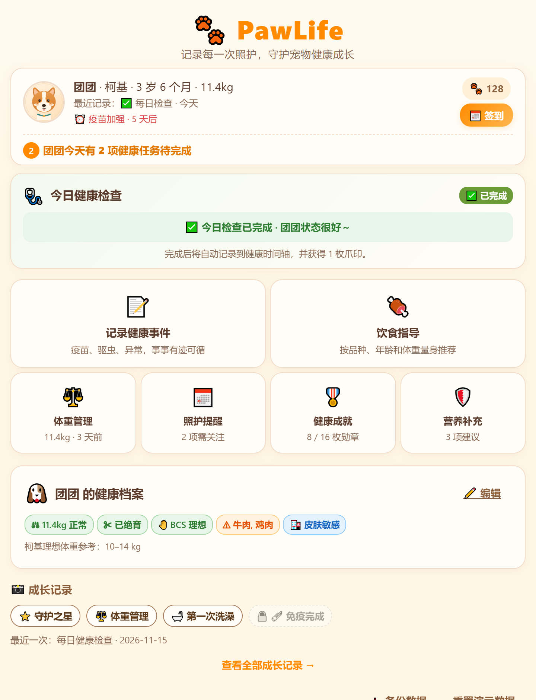
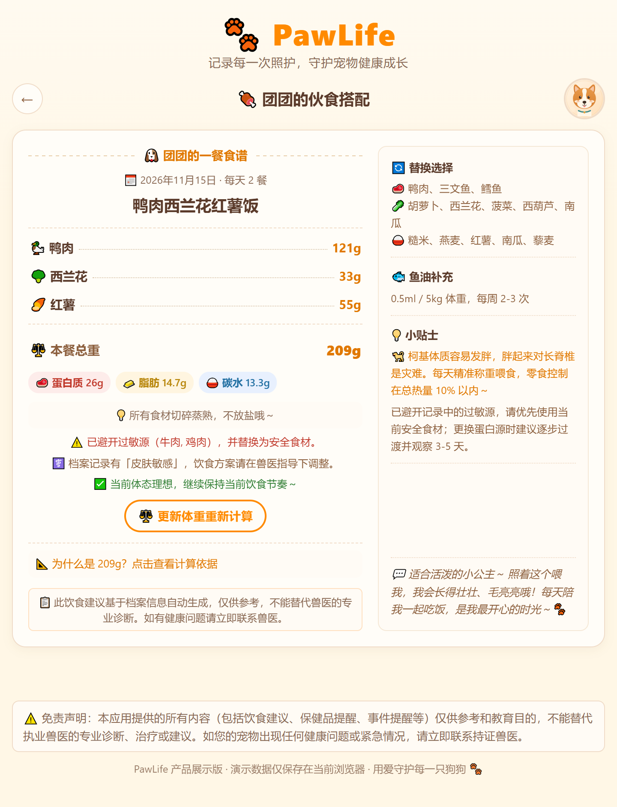
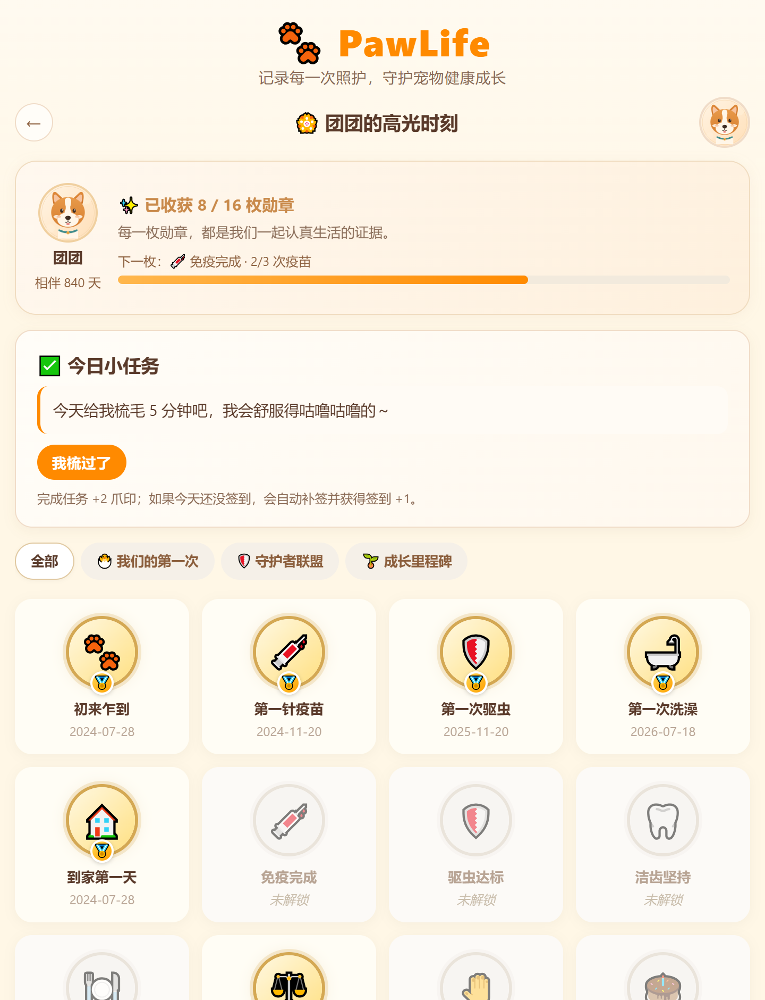
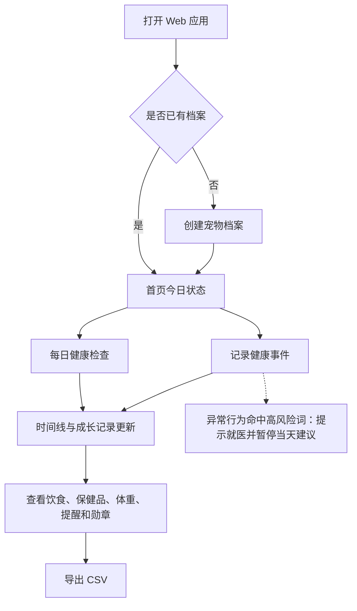
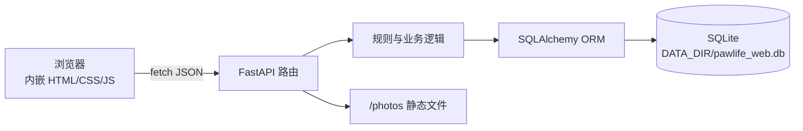
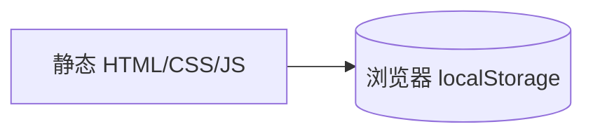
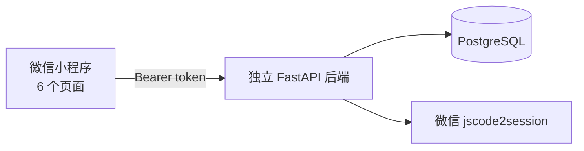

# PawLife | 狗狗健康管理与日常照护 Web 应用

## 1. 项目简介

PawLife 是一个面向养犬人的健康管理 Web 应用原型，围绕宠物档案、健康事件记录、饮食参考、体重与体况、日常提醒和轻量成长激励展开。应用使用狗狗第一人称的文案风格，重点服务于新手养犬人的日常记录和照护场景。

当前仓库包含三个性质不同的部分：

- **原始 Web 应用**：`pawlife_web.py`，Python + FastAPI + SQLite 的单文件全栈应用，是本项目的主要产品实现；
- **Showcase**：`showcase/`，独立的静态演示版，用浏览器演示数据展示页面和部分交互；
- **微信小程序**：`miniprogram/`，独立的小程序前端及 FastAPI + PostgreSQL 后端。

三者没有共用同一套数据库、用户体系或完整业务运行时，不能描述为已经打通的统一系统。PawLife 的输出是基于规则的照护参考，不是兽医诊断，也不替代线下就诊。

**文档导航**：[技术细节](docs/TECHNICAL_DETAILS.md) · [审计报告](docs/AUDIT.md)

---

## 2. 项目展示

### 2.1 Showcase 静态展示版

Showcase 是基于原始 Web 应用的功能和页面结构构建的**独立静态演示版本**：

- 包含首页、成长日记、伙食搭配、高光时刻、元气补给、身材管理、贴心闹钟 7 个页面；
- 页面标题、单列移动端结构、首页功能入口和子页面返回头与原始 Web 应用基本一致；
- 导航实现不同：原始 Web 应用在同一 HTML 内显示/隐藏子页面，Showcase 使用 hash 路由（如 `#/diet`）；
- 使用虚构演示狗狗「团团」和浏览器 `localStorage` 数据，不调用后端 API，不读写 SQLite，也不与原始应用共用业务逻辑；
- 饮食、保健品、提醒、勋章等规则是在 `showcase/js/` 中用 JavaScript 重新实现的，不是 Python 代码的同一运行时。

**仅在 Showcase 中出现或更完整的交互**：

- 体重图表的 30 天范围；
- 演示数据的 JSON 导出。

**原始 Web 应用有、Showcase 未实现的能力**：

- 真实照片上传与本地文件持久化；
- 兽医摘要和 CSV 导出；
- SQLite 数据库及后端规则运行。

因此，Showcase 适合用来浏览页面和演示交互，但不能作为原始 Web 应用已具备全部同名功能的证据。

| 首页 | 伙食搭配 |
| --- | --- |
|  |  |

| 身材管理 | 高光时刻 |
| --- | --- |
|  |  |

以上截图均由当前 `showcase/` 静态页面渲染，使用虚构演示数据。

本地预览：

```bash
python -m http.server 8080 -d showcase
# 打开 http://localhost:8080/
```

### 2.2 在线访问状态

当前**没有可访问的在线演示地址**。检查时仓库的 GitHub Pages 地址返回 404，仓库也没有已成功发布的演示站点。

仓库包含 `.github/workflows/deploy-showcase.yml`，仅用于发布 `showcase/`；但仓库的 Pages 站点尚未启用。需要仓库管理员在 **Settings → Pages → Source** 中选择 **GitHub Actions**，之后工作流才能发布。完成该设置前，不应把任何 GitHub Pages 地址视为可用。

### 2.3 三个部分的区别

| 部分 | 运行方式 | 数据来源 | 与原始 Web 应用的关系 |
| --- | --- | --- | --- |
| 原始 Web 应用 | FastAPI + 内嵌 HTML/CSS/JS | SQLite + 本地照片目录 | 主要产品实现 |
| `showcase/` | 纯静态文件 | `localStorage` 演示数据 | 独立静态演示，不共用后端/数据库/规则运行时 |
| `miniprogram/` | 微信小程序 + 独立 FastAPI | PostgreSQL | 独立子项目，不共享用户或宠物数据 |

---

## 3. 背景与目标

### 3.1 使用场景

以下场景来自产品文案和代码中的功能设计。仓库没有用户访谈、问卷或市场调研数据，因此这些内容是产品假设，不是已验证的用户研究结论。

从文案和功能取舍看，产品主要面向**新手养犬人**。代码中没有用户画像、地区、年龄、消费能力或用户规模等数据。

常见的日常问题包括：

- 疫苗、驱虫、洗澡、体重和异常观察分散在不同地方，难以形成连续记录；
- 不确定不同年龄、体重、品种和过敏史下该如何安排饮食；
- 照护事项依赖记忆，容易遗漏；
- 只能看到单次记录，难以观察体重和体况变化；
- 长期记录缺少反馈，不容易坚持。

### 3.2 设计目标

PawLife 以宠物档案为基础，把一次性的信息录入转化为后续可复用的数据：

1. 档案字段参与饮食、保健品、提醒和勋章的计算；
2. 健康事件进入统一时间线，并影响提醒和成长记录；
3. 用规则给出可解释的参考建议，而不是生成无法追溯的结论；
4. 用签到、任务和勋章提供轻量反馈，帮助维持记录习惯。

产品不试图替代兽医判断。高风险症状出现时，设计上的处理是提示就医并暂停当天的饮食和保健品建议；当前实现细节见 [技术细节](docs/TECHNICAL_DETAILS.md#event-rules)，修复记录见 [审计 A1](docs/AUDIT.md#a1)。

---

## 4. 核心功能

功能标记：

- **[Web 已实现]**：原始 Web 页面可直接使用；
- **[部分实现]**：后端或接口已经存在，但页面未完整接入；
- **[Showcase]**：只在静态演示版中提供；
- **[未实现]**：当前代码中没有完整实现。

### 4.1 宠物档案 [Web 已实现]

**目的**：建立后续营养、提醒和成长记录的基础数据。

**主要操作**：创建或编辑名字、品种、生日、体重、性别、绝育情况、过敏源、已知疾病、到家日期和建议洗澡间隔；可上传档案照片。

**系统结果**：创建档案时如填写体重，会同步一条当天体重记录；编辑档案时体重发生变化，也会追加记录。档案数据会被饮食、保健品、提醒、健康摘要和勋章复用。

**限制**：当前 Web 端只读取“最新创建的一只狗狗”，没有多宠物切换；档案照片上传可用，但头像盲盒的完整管理页面未接入。

### 4.2 首页与每日健康检查 [Web 已实现]

**目的**：让主人打开应用后快速看到今日状态和待办。

**主要操作**：

- 查看头像、名字、品种、年龄、体重、最近事件、最近提醒、爪印和连续签到天数；
- 完成每日健康检查，选择“一切正常”或“发现异常”并填写异常备注；
- 从 6 个入口进入记录、饮食、体重、提醒、成就和营养补充页面。

**系统结果**：每日检查写入一条 `每日检查` 事件，并奖励 1 枚爪印；同一天重复检查会被拒绝。

### 4.3 成长日记与时间线 [Web 已实现]

**目的**：集中记录疫苗、驱虫、发情、异常行为、洗澡和每日检查。

**主要操作**：选择事件类型和日期，填写对应详情；在时间线中按类型筛选、查看详情、编辑、删除和上传照片。

**系统结果**：

- 事件按日期倒序进入时间线；
- 不同事件生成狗狗第一人称反馈；
- 异常行为会匹配品种 × 症状决策树，并可生成兽医摘要；
- 正常记录事件可奖励爪印并触发勋章检查。

**高风险输入**：异常行为表单同时提供症状多选和补充描述。前端与后端使用同一套高风险词表及 22 条同义表达；否定表达和“上次已恢复”的历史描述会被跳过，命中后弹出紧急就医提醒，并由服务端记录风险标记。普通症状不会被自动升级为高风险；风险提示不构成诊断。多条高风险事件并存时按剩余事件重算暂停，编辑普通事件不会覆盖手动解除的状态。事件编辑/删除还会重算洗澡日期和健康相册引用，详见 [技术细节](docs/TECHNICAL_DETAILS.md#event-rules)。

### 4.4 伙食搭配 [Web 已实现]

**目的**：根据档案生成一餐食谱和每日喂食量参考。

**主要操作**：查看当前食谱、每餐食材克数、蛋白质/脂肪/碳水汇总、过敏源和疾病提示、计算依据；更新体重后重新计算。

**系统结果**：

- 根据体重、年龄阶段、绝育状态和性别计算 RER/DER，再换算每日总克数和每餐克数；
- 根据年龄和体型从 9 组食材组合中选择，并按过敏源替换食材；
- 展示食材营养换算和计算依据；
- 当天存在高风险暂停时，不展示饮食建议。

**关系**：依赖档案中的体重、生日、绝育、性别、品种、过敏源和疾病；体重变化会触发重新计算。具体公式、参数和食谱表见 [技术细节](docs/TECHNICAL_DETAILS.md#diet-rules)。

**限制**：所有数值是规则估算，1.5 kcal/g、宏量配比和食材营养表都是项目内参数，不是临床处方；代码不计算钙磷比。

### 4.5 元气补给 [Web 已实现]

**目的**：根据品种、年龄、体重、性别、绝育状态、异常行为历史和疾病，给出保健品方向性建议。

**主要操作**：查看推荐项目、推荐原因和狗狗口吻说明；在资料更新或事件记录后重新计算。

**系统结果**：基础规则命中后按合并键去重，保留优先级和原因；高风险暂停时返回暂停状态。

**限制**：没有剂量计算；推荐是启发式规则，不能替代兽医。具体规则见 [技术细节](docs/TECHNICAL_DETAILS.md#supplement-rules)。

### 4.6 身材管理 [Web 已实现]

**目的**：记录体重变化和 BCS 体况，辅助观察趋势。

**主要操作**：新增/删除体重记录，切换近 3 月、近 6 月、近 1 年趋势；选择偏瘦、理想或偏胖进行 BCS 评估。

**系统结果**：新增体重后会同步档案中的最新体重；体重和 BCS 变化参与相关勋章判定。

### 4.7 贴心闹钟 [Web 已实现]

**目的**：把疫苗、驱虫、洗澡、体重、体况和每日检查等待办集中展示。

**主要操作**：查看提醒和倒计时，按引导进入记录或体重页面。

**结果**：提醒是应用内计算和展示，不是短信、微信或系统推送。

**参数与边界**：疫苗提醒周期由后端 `VACCINE_REMINDER_DAYS` 统一提供（默认 1095 天，可通过环境变量调整），前端提醒页读取 `/api/health_check` 返回值，不再各自维护 365/1095。该参数是项目提醒设置，不是医学标准；不同疫苗的加强周期应由兽医决定。发情提醒使用统一的 `female` 性别枚举。

### 4.8 高光时刻与激励 [Web 已实现]

**目的**：记录签到、成长勋章和轻量任务反馈。

**主要操作**：

- 每日签到，累计连续天数；
- 查看 16 枚勋章、解锁日期和成长文案；
- 通过隐藏彩蛋进入每日测验；
- 在“高光时刻”页完成每日任务。

**系统结果**：签到 +1 爪印、答对测验 +2 爪印、完成任务 +2 爪印；任务完成时可自动补签。

**边界**：任务完成由后端防重复；签到里程碑字符串与 16 枚勋章定义的统计口径仍不完全一致（见 [审计 A10](docs/AUDIT.md#a10)）。

### 4.9 照片、成长相册与导出 [Web 已实现（健康照片） / 部分实现（头像盲盒）]

- 档案照片和事件照片可上传，限制 JPG/PNG、最大 2 MB，保存在 `DATA_DIR/photos/`；
- 非异常行为的事件照片会进入健康成长相册，异常行为照片用于事件记录和就诊展示；
- 首页健康成长相册展示事件照片，点击可删除；头像盲盒/肉垫影集接口仍存在，但当前页面没有完整的盲盒上传/管理入口；
- CSV 导出包含狗狗档案、事件和体重记录，不包含 BCS、签到、爪印历史或照片文件。

### 4.10 微信小程序 [独立子项目]

- 6 个页面：今日、记录、我的、时间线、饮食、保健品；
- 独立 FastAPI + PostgreSQL 后端，使用微信 `openid` 和 `owner_id` 隔离用户数据；
- 与 Web 应用不共享数据库、用户或宠物数据；
- 需要单独配置 `DATABASE_URL`、`WX_APPID`、`WX_SECRET` 和小程序 `baseUrl`；
- 当前未完成端到端验证，仓库也没有完整声明小程序后端所需依赖。详见 [技术细节](docs/TECHNICAL_DETAILS.md#miniprogram)。

---

## 5. 产品业务流程

下图反映当前 Web 页面可以走通的主路径。



高风险分支从前端症状/描述输入开始，前后端均会扫描并记录；它是风险提示流程，不是诊断流程。高风险记录会把当天饮食和保健品建议置为暂停，用户联系兽医后可手动恢复。

---

## 6. 系统架构

### 6.1 原始 Web 应用



- 单文件应用同时包含数据库模型、规则、API 和内嵌前端；
- 前端通过 `fetch` 调用同源 `/api/*`；
- 页面会加载 Google Fonts 外部资源；
- 没有独立前端构建、消息队列或微服务。

Web 应用当前有 37 个 HTTP 路由、8 张 SQLite 表；API 清单和规则细节见 [技术细节](docs/TECHNICAL_DETAILS.md)。

### 6.2 Showcase



Showcase 没有服务端、数据库或 API；页面和规则都在浏览器内运行。

### 6.3 微信小程序



三个部分相互独立，不应画成共享同一服务或数据层的统一架构。

---

## 7. 技术栈

### 后端

| 技术 | 用途 |
| --- | --- |
| Python 3 | Web 应用和小程序后端 |
| FastAPI 0.136.3 | HTTP 路由和内嵌页面返回 |
| Uvicorn 0.47.0 | ASGI 服务器 |
| SQLAlchemy 2.0.49 | ORM 和数据库访问 |
| Pydantic 2.13.4 | 请求模型和字段校验 |
| python-multipart 0.0.29 | 文件上传 |

### 前端

| 技术 | 用途 |
| --- | --- |
| 原生 HTML / CSS / JavaScript | Web 页面渲染、路由切换和交互，无前端框架 |
| 原生 SVG | 体重趋势图 |
| 微信小程序原生技术 | WXML / WXSS / JS 页面 |

### 数据与部署

| 技术 | 用途 |
| --- | --- |
| SQLite | Web 应用本地数据库 |
| 本地文件目录 | 照片存储；头像盲盒照片以 Base64 存入数据库 |
| PostgreSQL | 小程序后端数据库 |
| GitHub Actions | `showcase/` 的 Pages 发布工作流；站点尚未启用 |
| 微信开发者工具 | 小程序预览和配置 |

### AI 工具

AI 工具只用于开发过程中的需求整理、代码生成、调试和文档整理；运行时不调用大模型或第三方 AI API。

---

## 8. 项目目录结构

```text
.
├── README.md
├── requirements.txt              # Web 应用依赖
├── pawlife_web.py                # 原始 Web 应用：模型、规则、API、内嵌前端
├── docs/
│   ├── AUDIT.md                  # 当前审计发现与验证记录
│   └── TECHNICAL_DETAILS.md      # 数据模型、API、规则和实现细节
├── showcase/                     # 独立静态展示版
│   ├── index.html
│   ├── css/
│   ├── js/
│   └── assets/images/
├── tests/                        # 核心规则回归测试
│   └── test_core_rules.py
├── miniprogram/                  # 微信小程序及其独立后端
│   ├── app.js / app.json / app.wxss
│   ├── pages/
│   ├── components/
│   ├── utils/
│   ├── pawlife_backend.py
│   └── database_migration.sql
└── .github/
    └── workflows/
        └── deploy-showcase.yml   # 仅发布 showcase/
```

本地运行后可能生成 `pawlife_web.db`、`photos/` 等文件；它们属于运行产物，已被 `.gitignore` 排除，不作为源码目录的一部分。

---

## 9. 本地运行

### 9.1 原始 Web 应用

环境要求：Python 3 和 pip。依赖版本以 `requirements.txt` 为准。

```bash
git clone https://github.com/lingzi49/pawlife.git
cd pawlife

python -m venv .venv
# Windows
.venv\Scripts\activate
# macOS / Linux
source .venv/bin/activate

pip install -r requirements.txt
```

启动：

```bash
python pawlife_web.py
```

默认监听 `0.0.0.0:8000`，并尝试自动打开 `http://127.0.0.1:8000`。首次启动会自动创建 `pawlife_web.db`，并在缺少「曦曦」演示狗时创建演示档案。

可用环境变量：

| 变量 | 作用 |
| --- | --- |
| `DATA_DIR` | 指定数据库和照片目录，适合持久化磁盘 |
| `PORT` | 覆盖默认端口 8000 |
| `VACCINE_REMINDER_DAYS` | 疫苗提醒周期，默认 1095 天；属于项目提醒参数，不是医学标准 |
| `ALLOWED_ORIGINS` | 逗号分隔的跨域来源白名单；默认为空，仅允许同源访问 |

也可以直接启动 Uvicorn：

```bash
uvicorn pawlife_web:app --host 127.0.0.1 --port 8000
```

本次文档核验使用临时 `DATA_DIR` 启动服务，确认 `GET /` 和 `GET /api/health_check` 返回 200；`tests/test_core_rules.py` 覆盖高风险匹配、RER/DER 和过敏过滤的关键规则。完整 API 与浏览器回归仍未建立持续测试体系。

### 9.2 Showcase

```bash
python -m http.server 8080 -d showcase
# 打开 http://localhost:8080/
```

Showcase 是纯静态文件，不需要安装 Python 依赖，也不需要启动 FastAPI。

### 9.3 微信小程序

需要在微信开发者工具中打开 `miniprogram/`，并单独配置后端地址、PostgreSQL、微信 AppID/Secret 和数据库迁移。仓库没有提供小程序后端的独立依赖文件或启动脚本；配置步骤和未验证事项见 [技术细节](docs/TECHNICAL_DETAILS.md#miniprogram)。

---

## 10. 数据与隐私

### 10.1 原始 Web 应用

- 数据库默认位于项目目录下的 `pawlife_web.db`，可用 `DATA_DIR` 改到其他目录；
- 事件照片保存在 `DATA_DIR/photos/`，头像盲盒照片以 Base64 存入 `dogs.photos`；
- CSV 导出包含档案、事件和体重记录，不包含照片文件；
- 首次启动会在缺少「曦曦」时自动创建演示数据；
- Web 端没有登录、用户隔离或权限控制；CORS 默认不开放跨域，如需调试可显式设置 `ALLOWED_ORIGINS`；
- 单机本地使用时数据只存在本机；如果直接暴露到公网，任何访问者都可能读写同一份数据。部署前需要自行补充认证、访问控制和 HTTPS；
- Web 端不需要 API Key；页面会向 Google Fonts 发起外部请求（`fonts.googleapis.com` / `fonts.gstatic.com`），运行时不调用业务第三方 API，也不调用大模型；
- 仓库不包含真实用户数据；运行时录入的档案、照片和记录由使用者自行负责保管。

### 10.2 Showcase

- 只使用虚构演示数据，保存键为 `pawlife.showcase.v2`；
- 不调用后端 API，也不向原始应用发送数据请求；
- 清除浏览器站点数据或点击“重置演示数据”即可恢复初始状态。

### 10.3 微信小程序

- 使用微信登录，后端保存 `openid`、会话信息和用户填写的宠物档案；
- 数据存储在配置的 PostgreSQL 中，照片保存在后端 `data/photos/`；
- 需要配置 `DATABASE_URL`、`WX_APPID` 和 `WX_SECRET`；登录流程会向微信 `jscode2session` 发起请求；
- 小程序按 `owner_id` 做数据隔离，但与 Web 应用之间没有数据同步，二者是独立的数据域。

---

## 11. 项目状态与限制

### 11.1 已实现

- 宠物档案创建、编辑和档案照片上传；
- 健康事件记录、编辑、删除、筛选、事件照片和兽医摘要；
- 饮食食谱、RER/DER 计算、过敏过滤和计算依据；
- 保健品规则与去重；
- 体重记录、SVG 趋势图、BCS 体况评估；
- 应用内照护提醒；
- 每日健康检查、签到、每日任务入口、16 枚勋章和每日测验；
- 首页每日养宠提示、健康成长相册；
- CSV 导出；
- 静态展示版 `showcase/`；
- GitHub Pages 工作流配置（站点尚未启用）；
- 独立的小程序页面和后端代码（需自行配置和验证）。

### 11.2 部分实现

- **头像盲盒**：上传/删除/头像接口存在，页面没有完整管理入口；
- **微信小程序**：前后端代码存在，但依赖、配置和端到端链路未验证。

### 11.3 未实现或未验证

- Web 端多宠物、多用户账号、认证、权限和数据隔离；
- 小程序与 Web 应用的用户/宠物数据同步；
- 真正的疫苗、驱虫、洗澡推送提醒；
- 多用户并发、备份恢复和容量治理；
- 临床验证、专业审核流程和规则版本管理。

### 11.4 已知限制

- Web 端默认操作最新创建的一只狗狗，且没有认证/权限；
- CORS 默认关闭跨域，但不能替代认证；公网部署前仍需访问控制；
- 疫苗提醒周期是项目参数，不是统一医学标准；
- 高风险识别是关键词/同义表达提示，不覆盖所有急症，也不能替代兽医；
- 事件编辑/删除会重算洗澡日期、风险暂停和健康相册引用；勋章和爪印按成就记录保留，不回滚；
- 数据库没有外键，迁移是启动时增量加列，删除操作容易留下孤儿数据；
- `FakeRedis` 是进程内缓存，多进程部署时幂等保护不共享；
- 自动化测试只覆盖部分核心规则，未覆盖全部 API、浏览器和数据库迁移；
- 规则和食材数据没有经过完整临床验证，不能替代兽医；
- Pages 站点尚未启用，当前没有可访问的在线演示地址。

更完整的问题、影响和状态见 [审计报告](docs/AUDIT.md)。

---

## 12. 开发说明

PawLife 的开发过程使用了 AI 辅助工具，主要用于需求整理、代码生成、调试和文档整理。需要明确区分：

- **开发过程**：AI 工具参与了原型实现和文档编写；
- **运行过程**：饮食、保健品、提醒、勋章和风险提示由本地 Python/JavaScript 规则和结构化数据计算，不依赖大模型实时推理；
- **验证边界**：AI 辅助生成的代码和规则不等于经过临床或专业验证；健康相关决策应由执业兽医确认。

项目采用单文件全栈结构，`pawlife_web.py` 同时包含数据库模型、规则函数、API 路由和内嵌前端，适合快速原型验证，但不是多人协作或生产级工程结构。

`PawLife_兽医知识审查报告.md` 是早期本地材料，基于更早版本代码，部分行号和数量已过时，未纳入当前版本库；其中的医学审查结论不能替代当前代码事实或新的专业审核。

---

## 13. 免责声明

本项目仅用于学习、产品原型探索和健康信息整理，不构成兽医诊断或治疗建议。饮食、保健品、提醒和风险提示均基于有限的规则模型与内置知识，可能存在错误、遗漏或不适用于个体宠物的情况。若宠物出现持续、严重或急性症状，请及时联系执业兽医。使用本项目产生的任何决策与后果，由使用者自行承担。
