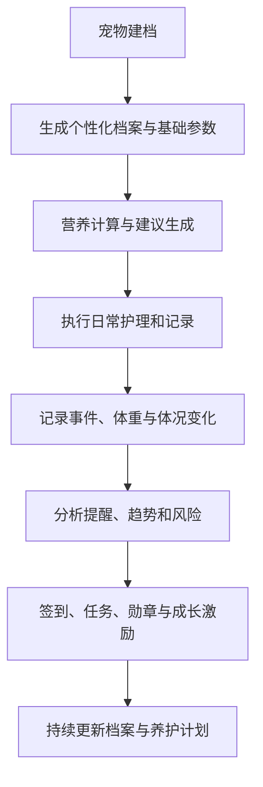
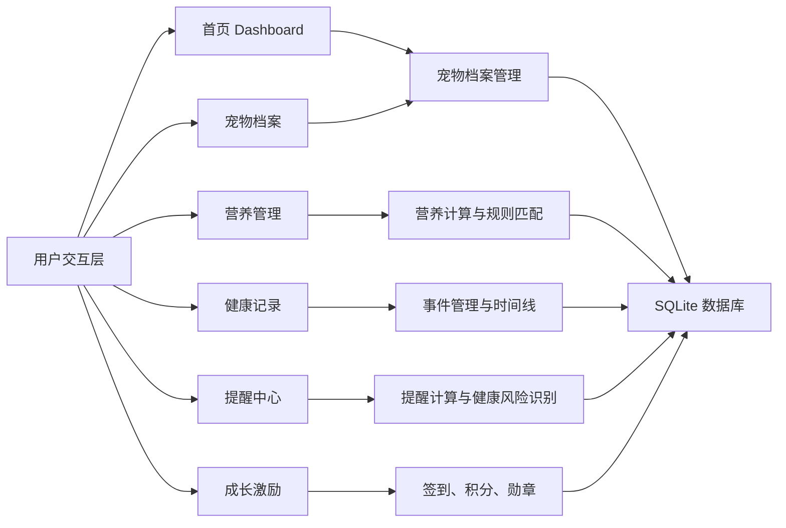

# PawLife | 宠物健康管理与日常照护平台

面向新手养犬人的个性化健康管理工具，让日常照护更有计划，让宠物成长有迹可循。

PawLife 是一款基于宠物档案的健康管理 Web 应用。它不追求“实时 AI 诊断”，而是把犬只的基础档案、日常护理记录、体重变化、提醒事项和健康风险识别整合在一起，帮助主人把零散信息整理成一份可持续维护的宠物健康记录。

从代码实现看，PawLife 的核心价值在于三点：

- 以宠物数字档案为基础，为每只犬只提供个性化养护参考；
- 将健康事件、日常护理和照护提醒系统化；
- 通过记录、趋势分析、任务和积分激励，帮助用户持续养成管理习惯。

这个项目本身是一个以 Python + FastAPI 构建的单文件 Web 原型，开发过程中使用了 AI Agent 协助需求整理、代码生成、文档整理和逻辑迭代，但运行时的核心逻辑仍然是规则引擎和结构化数据，而不是依赖大模型实时推理。

---

## 项目预览

目前仓库中没有现成截图资产，因此以下为占位区域，后续补充真实界面截图后可直接替换：

- Dashboard / 首页看板
- 宠物数字档案
- 营养计算与个性化建议
- 健康事件时间线
- 体重趋势图
- 照护提醒中心
- 签到与勋章系统

> 需要补充：真实页面截图（至少 4–6 张），用于展示首页、档案、饮食建议和健康时间线。

---

## 背景与用户痛点

### 用户场景

新手养犬人通常会遇到以下真实问题：

- 健康信息分散：体重、疫苗、驱虫、洗澡、异常行为等被记录在不同地方，难以形成连续档案；
- 对照护知识了解有限：不同犬种、年龄段、体重和过敏史会带来不同的养护要求；
- 日常事项容易遗漏：疫苗、驱虫、洗澡、体重记录和观察事项经常被忽略；
- 长期趋势难以看到：只记录当下，无法形成健康变化轨迹，也难以判断是否需要调整日常计划。

### 产品设计方向

PawLife 的设计目标并不是替代兽医，而是帮助主人把宠物健康管理从“零散记忆”提升到“可持续执行”。因此，产品以以下逻辑构建：

用户场景 → 现有问题 → 结构化档案 → 个性化养护建议 → 健康事件记录 → 提醒与趋势反馈 → 持续更新养护计划

### 产品价值

1. 个性化：基于宠物档案给出更符合个体状态的饮食和护理建议；
2. 系统化：把健康记录、提醒与日常事项集成在统一入口；
3. 持续化：通过签到、任务、积分和勋章机制帮助用户形成长期管理习惯。

---

## 核心功能

### 1. 宠物数字档案

PawLife 的核心数据对象是狗狗档案，而不是单一页面展示。档案中记录了：

- 名称、品种、生日、体重、性别、绝育状态；
- 过敏源、已知疾病、到家日期；
- 建议洗澡间隔和最近洗澡日期；
- 头像、照片、成长相册等记录信息。

这些字段会在后续的饮食建议、保健品推荐、提醒和趋势分析中被复用。也就是说，档案不是展示信息，而是整个系统的基础数据对象。

### 2. 个性化营养与养护建议

Web 应用实现了基于规则的营养建议模块，具体包括：

- RER 与 DER 计算：根据体重、年龄、性别、绝育状态等参数进行推算；
- 每日喂食量参考：将能量需求转换为每日建议喂食克数；
- 食材推荐：生成年龄/体型对应的食材组合；
- 过敏食材过滤：自动排除用户已记录的过敏源；
- 保健品建议：基于年龄、毛发、关节、肠胃、皮肤、寄生虫等条件进行规则匹配；
- 犬种和年龄相关建议：例如体重管理、皮肤护理、关节保护等。

这里的关键是：它是规则引擎输出，不是大模型实时推理的医生判断。

### 3. 健康记录与照护提醒

已实现的日常健康记录功能包括：

- 事件记录：疫苗、驱虫、发情、异常行为、洗澡和日常检查；
- 体重记录：支持新增和趋势追踪；
- BCS 体况评估：薄、理想、偏重三档评估；
- 图片及附件：事件可附带照片；
- 时间线展示：按日期倒序展示“汪生时间线”；
- 兽医摘要：对异常事件可生成类就诊摘要；
- CSV 导出：导出犬只档案和历史记录。

提醒机制并不等同于短信或微信推送。代码中更接近“在应用内计算并展示的待办提醒与倒计时”，例如洗澡、驱虫、疫苗、保健品和体重相关提醒。

### 4. 健康追踪与风险控制

这一模块包括：

- 体重趋势图：按 30/90/180/365 日范围查看变化；
- BCS 评分：追踪体况状态变化；
- 风险关键词识别：对“呕吐、便血、抽搐、呼吸困难”等高风险词做识别；
- 风险告警：命中关键词后给出提示并暂停相关建议；
- 就医引导：提醒用户及时就医，而不是对症下药。

需要明确：系统提供的是健康管理参考，不替代兽医诊断。

### 5. 游戏化与成长激励

PawLife 同时具备轻量游戏化闭环：

- 每日签到：每日签到并累计连续天数；
- 爪印积分：签到、任务完成可获得积分；
- 每日任务：体重记录、梳毛、查看耳朵、散步等任务；
- 勋章系统：基于第一次记录、护理完成、体重管理等条件解锁；
- 成长相册：健康照片与成长记录汇总；
- 用户反馈：每次操作后有狗狗口吻回复和鼓励文本。

这些机制服务于用户坚持记录和执行的行为闭环，而不是“功能堆叠”。

---

## 核心业务流程



### 1. 宠物建档与个性化建议流程

- 用户创建宠物档案；
- 输入品种、生日、体重、过敏源、基础病史等；
- 系统根据这些数据生成个性化营养、保健品和护理建议；
- 随后所有健康记录都基于这个档案继续叠加。

### 2. 日常照护与健康记录流程

- 用户在首页/记录页新增疫苗、驱虫、异常行为、洗澡和体重信息；
- 系统进行字段校验和事件去重；
- 所有数据写入数据库并回填到首页、时间线和提醒模块；
- 用户能查看事件列表、状态变化和成长记录。

### 3. 健康追踪与风险提醒流程

- 用户记录体重、BCS、异常行为；
- 系统比较历史数据，生成趋势和风险指标；
- 若命中高风险关键词，弹出警示并暂停部分建议；
- 用户获得更清晰的观察建议和就医提醒。

### 4. 用户持续使用闭环

- 每日签到和任务使用户保持活跃；
- 记录和提醒帮助用户定期照护；
- 勋章和积分形成反馈；
- 趋势变化让用户看到宠物成长轨迹，从而持续维护宠物档案。

---

## 产品架构



系统目前采用两层主要架构：

- Web 端：一个 Python + FastAPI + SQLite 的单文件全栈应用；
- 小程序端：单独的微信小程序工程，后端代码也另行实现，尚未视为统一多端产品。

---

## 技术栈

| 类别 | 实际使用 |
|------|------|
| 前端 | 内嵌 HTML / CSS / JavaScript，直接由 FastAPI 返回页面 |
| 后端 | Python 3 + FastAPI + Uvicorn |
| API 框架 | FastAPI |
| ORM | SQLAlchemy |
| 数据库 | SQLite（主 Web 应用） |
| 图表库 | 原生 SVG（体重趋势） |
| 规则计算 | Python 规则引擎和结构化数据逻辑 |
| 开发工具 | Python 3、SQLite、Git |
| AI 辅助工具 | AI Agent / LLM，用于需求整理、代码生成、文档和规则迭代 |

> 说明：项目中并没有发现独立的 React、Vue、Next.js、Node.js 运行时，也没有使用大模型做运行时诊断。主应用是单文件全栈工程。

---

## AI-assisted Development & Vibe Coding

### 为什么使用 Vibe Coding

PawLife 的开发过程体现了典型的“AI 赋能原型快速搭建”方式：产品想法、用户流程和功能结构可以通过 AI 辅助快速落地成可运行的 Web 原型，不需要一开始就搭建复杂工程化体系。

在这个项目中，AI Agent 主要用于：

- 需求梳理与功能拆解；
- 产品结构和页面逻辑的快速生成；
- 数据字段、规则和代码结构的组织；
- 业务逻辑原型的迭代与调试；
- 文档整理和知识条目的结构化表达。

### 人工负责什么

人工在项目中承担的工作更偏“判断、评审和质量控制”：

- 产品定位与需求边界判断；
- 业务规则检查；
- 数据准确性审查；
- 健康内容的合规和风险边界控制；
- 功能验收与交互细节优化。

### AI 的边界

PawLife 运行时不是一个“实时 AI 诊断系统”。真正运行的核心是在 Python 里实现的规则引擎：

- 体重参数计算；
- RER / DER 逻辑；
- 高风险症状拦截；
- 事件生成和提醒状态；
- 任务、积分和勋章判定。

因此，这个项目更准确的定位是：AI 辅助开发的宠物健康管理产品原型，而不是依赖大模型做实时医疗判断的系统。

---

## 项目目录

```text
.
├── README.md
├── requirements.txt
├── pawlife_web.py
├── docs/
│   └── AUDIT.md
├── PawLife_兽医知识审查报告.md
├── miniprogram/
│   ├── app.js
│   ├── app.json
│   ├── app.wxss
│   ├── database_migration.sql
│   ├── pawlife_backend.py
│   ├── components/
│   ├── pages/
│   └── utils/
├── photos/
├── pawlife_web.db
└── .gitignore
```

### 关键文件说明

- `pawlife_web.py`：主 Web 应用入口，包含数据库模型、规则逻辑、事件处理和内嵌前端；
- `docs/AUDIT.md`：审计文档，记录系统架构、数据模型和功能细分；
- `miniprogram/pawlife_backend.py`：小程序后端，可视为独立开发的子系统；
- `miniprogram/`：微信小程序前端及其对应逻辑；
- `requirements.txt`：项目运行依赖；
- `PawLife_兽医知识审查报告.md`：知识条目和风险内容审查材料。

> 需要说明：主 Web 应用和小程序并不是完全统一的多端工程；当前仓库中它们更像“同一产品概念下的不同代码分支/子项目”。

---

## 本地运行

### 1. 克隆仓库

```bash
git clone https://github.com/lingzi49/pawlife.git
cd pawlife
```

### 2. 创建虚拟环境

```bash
python -m venv .venv
# Windows
.venv\Scripts\activate
# macOS / Linux
source .venv/bin/activate
```

### 3. 安装依赖

```bash
pip install -r requirements.txt
```

### 4. 配置环境变量

当前主 Web 应用默认使用本地 SQLite，运行时无需额外配置。部署时可通过环境变量：

- `DATA_DIR`：指定数据库和照片目录的持久化路径；
- `PORT`：覆盖默认端口；
- 其他变量仅在部分部署场景中使用。

仓库中未发现现成的 `.env.example` 文件，因此本地开发时推荐直接使用本地默认路径。

### 5. 初始化数据库

首次启动时，程序会自动创建 `pawlife_web.db` 及必要表结构，并执行简单的列迁移逻辑。无额外 SQL 初始化脚本要求。

### 6. 启动后端服务

```bash
python pawlife_web.py
```

默认访问地址：

```text
http://127.0.0.1:8000
```

### 7. 访问 Web 页面

在浏览器中打开上述地址即可进入应用。

---

## 数据安全与健康免责声明

- PawLife 提供的营养建议、提醒和风险提示仅作为日常照护参考，不构成医学诊断或治疗建议；
- 如果存在严重或紧急异常症状，应及时联系兽医；
- 健康数据、知识条目和规则需要持续更新和专业审核；
- 创建档案、体重记录和事件记录并不意味着代替专业医疗判断；
- 当前系统更适合帮助主人进行健康管理、档案记录和提醒，而不是替代临床医疗决策。

---

## 项目现状与未来规划

### 已实现

- 宠物档案管理；
- 事件记录（疫苗、驱虫、感染/异常行为、洗澡等）；
- 体重记录与趋势分析；
- BCS 体况评估；
- 营养与保健品规则建议；
- 高风险关键词识别与提示；
- 提醒中心；
- 签到、任务、积分和勋章；
- 照片与成长记录；
- CSV 导出与时间线展示。

### 部分实现

- 微信小程序前端/后端工程已存在，但当前更像独立子项目；
- 小程序与主 Web 应用之间的完整联调和统一数据层尚未形成最终闭环；
- 仅在单人/单宠物场景下可较稳定运行。

### 规划中

- 多宠物档案；
- 多用户与账号体系；
- Web 与微信小程序的统一数据打通；
- 更完善的提醒推送能力；
- 更深入的健康知识审核机制；
- 用户行为分析与个性化健康管理方案优化。

---

## 审计结论

根据代码审计，PawLife 更准确的定位是：

PawLife 是一款面向新手养犬人的个性化宠物健康管理与日常照护 Web 应用。

它不是一个依赖大模型实时推理的宠物 AI 诊断平台，也不是一个已完成的多端生产系统；而是一款以宠物档案为中心、以规则驱动的健康管理原型，聚焦日常照护、健康事件记录、提醒管理和长期趋势追踪。

这个定位与代码实现更一致，也更符合仓库中真实已经落地的功能边界。

---

## 贡献与交流

如果你想参与这个项目，最有价值的贡献方式包括：

- 改进日常提醒和健康趋势逻辑；
- 完善宠物档案字段与规则可解释性；
- 优化前端展示与交互体验；
- 评审健康知识库和风险规则；
- 扩展多宠物、多用户和小程序联调能力。

欢迎在 GitHub 上提交 issue、讨论和 PR。

---

## 项目局限

- 目前是**个人原型项目**，功能与稳定性以验证产品逻辑为目标，非生产级。
- 数据覆盖有限 — 内置 34 个犬种、31 个高危症状词，尚不能覆盖全部品种与疾病场景。
- 规则模型基于公开知识与行业标准搭建，**不能替代专业诊疗**，且存在边界情况未被覆盖。
- 知识条目虽经过约 140 条的专业校验，但仍**需要更多真实案例与持续专家审核**。
- 当前为单用户 / 单狗狗模型，无认证与多账号体系。

---

## 后续迭代方向

- [ ] 增加前端交互页面与可视化健康报告
- [ ] 增加更多犬种、症状与疾病规则
- [ ] 增加用户反馈机制（“这条建议有用吗 / 不准确”）
- [ ] 增加知识库检索与浏览页面
- [ ] 增加多语言支持
- [ ] 接入更严格的专业审核流程（专家在线复核、版本管理）
- [ ] 增加风险分级模型（由简单规则升级为权重化评分）

---

## 免责声明

**本项目仅用于学习、产品原型探索和健康信息整理，不构成兽医诊断或治疗建议。** 所有输出均基于有限的规则模型与公开知识，可能存在错误或遗漏。若宠物出现持续、严重或急性症状，请及时咨询专业兽医。使用本项目产生的任何决策与后果，均由使用者自行负责。

---

## 致谢

- 项目中的营养计算与判断逻辑参考 NRC 犬猫营养标准、AAFCO、WSAVA 疫苗指南及默克兽医手册等公开资料。
- 感谢 AI Agent 在脚本生成、文献解析与内容整理中提供的高效辅助，以及人工复核在风险控制上的关键把关。
