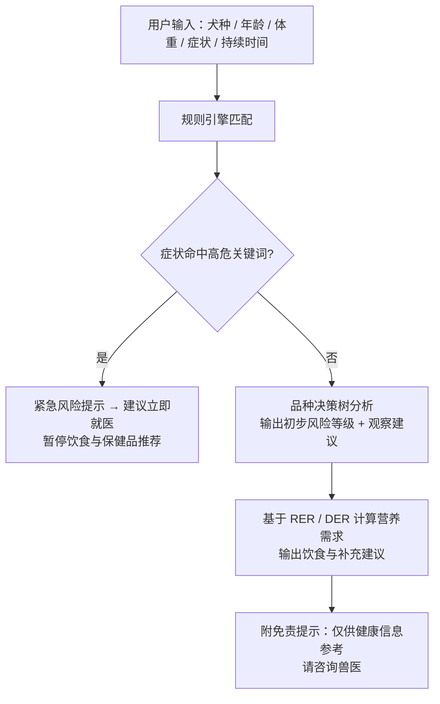

# PawLife 宠物健康评估平台

> **AI-assisted Pet Health Assessment Prototype** — 用 AI Agent 辅助构建的宠物健康初筛与营养建议原型

<p align="center">
  
  
  
  
  
</p>

---

## 项目简介

PawLife 是一个面向宠物主的**宠物健康评估与日常健康管理原型**，聚焦“难以判断宠物轻微症状及基础营养需求”这一细分痛点。项目通过 AI Agent 辅助开发的规则模型，提供犬种体征参考、常见症状初步判断和基础营养建议。

项目不依赖大型模型实时推理，而是将兽医领域的公开知识沉淀为**可解释的规则模型**：一旦输入犬种、年龄、体重与症状描述，系统会给出基于规则的初步风险提示、观察建议和营养参考。这种设计让每一次判断都有明确依据，也便于后续迭代和审核。

需要特别说明的是：**本项目是一个 AI 辅助开发的学习与产品原型探索项目，不是医疗诊断工具。** 所有输出仅用于健康信息的初步参考，不能替代兽医的专业诊断。

**面向人群**：新手铲屎官、宠物健康产品运营/产品经理、对 AI 辅助开发感兴趣的开发者。

---

## 项目背景 / 用户痛点

宠物主在照顾毛孩子的过程中，常常遇到以下困境：

- **不知道轻微症状是否需要就医** — 偶尔呕吐、精神不振是正常反应还是疾病信号，缺乏判断依据。
- **不同犬种体征差异导致判断困难** — 大型犬与小型犬、短鼻犬与双层毛犬在体重、饮食、护理频率上差异巨大，通用建议经常失效。
- **网上信息碎片化且专业度不一** — 社交媒体与搜索结果的结论互相矛盾，普通用户难以分辨信源质量。
- **营养剂量建议缺乏标准化** — 喂食量、保健品补充多凭感觉，缺少基于体重与生命阶段的量化参考。
- **专业内容需要风控与审核** — 健康类内容一旦出错可能造成伤害，必须建立来源记录与人工复核机制。

本项目尝试用 **“犬种体征 — 症状判断 — 营养建议”** 的基础评估逻辑，配合 AI 辅助开发与人工复核，给出一个初步、透明、可迭代的解决方案。

---

## 核心功能

### 1. 犬种体征信息整理
内置 34 个常见犬种的体征字段（理想体重范围、体况评估、护理频率等），作为后续所有判断的“品种上下文”。不同品种在饮食计算、洗澡间隔、年龄阶段划分上都会走不同的规则分支。

### 2. 症状判断逻辑
- 内置 **31 个高危症状关键词**（如吐血、便血、抽搐、呼吸困难等），命中即触发紧急就医提示，并暂停饮食与保健品推荐 14 天，防止用户自行处理延误病情。
- 对非高危症状，通过**品种决策树**给出初步风险等级、观察建议与安抚话术。

### 3. 营养建议规则
基于 **RER（静息能量需求）→ DER（每日能量需求）→ 每日喂食克数** 的完整计算链条，结合犬种、年龄、体重、绝育状态、过敏源，输出个性化饮食建议。9 种（年龄阶段 × 体型）食材组合并自动过滤过敏食材。

### 4. 疾病与营养知识库
- 以**结构化字段**组织疾病与营养数据条目（详见下文「数据结构设计」）。
- 累计整理、校验约 **140 条**核心疾病与营养相关的静态知识条目，覆盖食材营养数据、保健品规则、症状决策树、日常贴士等。
- 所有条目记录来源，便于追溯与复核。

### 5. AI 文献解析与内容整理
利用 AI Agent 解析兽医行业公开资料与专业文献，辅助完成知识条目初稿的提取、翻译与结构化。AI 负责“提速”，人工负责“把关”。

### 6. 人工复核与内容风控机制
建立 **AI 初筛 + 人工复核** 的双层机制。专业知识条目标记 `review_status` 字段，高风险内容强制引导就医，全部条目接受独立专业审查（详见「内容审核与风控」）。

### 7. 初版规则计算模型
将上述逻辑落地为可运行的 Python 规则引擎，覆盖饮食计算、保健品推荐（14 条规则）、风险检测、照护提醒、勋章激励等模块。

### 8. 附加：日常健康管理（原型功能）
在评估逻辑之上，原型还实现了体重趋势、事件记录（疫苗/驱虫/发情/洗澡）、照护提醒、签到与勋章等健康管理功能，用于验证“评估 + 管理”的产品闭环。

---

## 产品逻辑 / 用户流程



### 异常症状记录流程（高风险分支）

```
记录异常行为 → 输入症状描述
→ 命中高危关键词?
   是 → 弹出紧急警告 → 建议立即就医
        → 暂停饮食/保健品推荐（14 天）
        → 记录风险日志
   否 → 品种决策树分析 → 生成安抚与观察建议
```

---

## 数据结构设计

规则模型的可解释性建立在**结构化字段**之上。以下是项目设计并使用的核心字段（知识库条目示例）：

| 字段名 | 说明 | 示例 | 用途 |
|--------|------|------|------|
| `breed` | 犬种 | 柴犬 | 定位品种体征上下文 |
| `age` | 年龄（或生命阶段） | 幼犬 / 成犬 / 老年犬 | 匹配年龄相关规则 |
| `weight` | 体重（kg） | 9.5 | 营养计算与体况判断输入 |
| `symptom` | 症状描述 | 偶发性呕吐 | 症状匹配入口 |
| `severity` | 严重程度 | 轻度 / 中度 / 重度 | 风险分级 |
| `duration` | 持续时间 | 1-2 天 | 判断急缓与就医紧迫度 |
| `possible_condition` | 可能的疾病方向 | 肠胃炎初筛 | 输出参考信息 |
| `nutrition_type` | 营养类型 | 蛋白质 / 钙 / Omega-3 | 营养建议分类 |
| `dosage_rule` | 剂量规则 | 按体重计算喂食量 | 量化建议 |
| `risk_level` | 风险等级 | 低 / 中 / 高 / 紧急 | 决定处理路径 |
| `source` | 信息来源 | NRC 犬猫营养标准 | 可追溯性 |
| `review_status` | 复核状态 | reviewed / pending / rejected | 内容风控 |

**为什么要结构化字段？**

1. **可解释** — 每条判断都能说明“依据哪个字段、命中哪条规则”，而不是黑盒。
2. **可审核** — `source` 与 `review_status` 让每一条知识都能追溯来源、标记复核状态。
3. **可扩展** — 新增犬种、症状、营养条目时，只需补充数据，无需重写逻辑。

> 注：以上为项目知识库的字段设计示例。仓库内运行的 `pawlife_web.py` 使用 SQLAlchemy ORM + SQLite 持久化，具体表结构见 `docs/AUDIT.md`。

---

## AI Agent 工作流

本项目将 AI Agent 定位为**提效工具**，人工复核定位为**风险控制**。完整工作流如下：

```
资料收集
   ↓
AI 文献解析（公开资料与专业文献）
   ↓
字段提取（结构化为上文所示字段）
   ↓
Python 脚本生成（AI Agent 辅助搭建规则模型）
   ↓
规则模型测试（示例输入 → 校验输出）
   ↓
人工复核（专业审核 + 数据校验）
   ↓
数据入库 / 整理
```

**工作流原则**：AI 负责“批量、快速、结构化”，人类负责“判断、审核、兜底”。二者结合才能既提升效率，又控制专业内容的风险。

---

## 内容审核与风控

本项目明确遵循以下风控原则：

- ✅ **不提供医疗诊断** — 项目定位是健康信息参考与初步评估，不构成诊断。
- ✅ **高风险症状引导就医** — 命中高危关键词立即建议咨询兽医，并暂停自我处理类建议。
- ✅ **专业内容记录来源** — 知识条目标记来源字段，保证可追溯。
- ✅ **AI 输出必须人工复核** — 所有 AI 生成的专业内容在入库前必须经过人工二次复核。
- ✅ **`review_status` 标记** — 数据条目通过复核状态字段管理审核进度。

项目累计整理了约 **140 条**疾病与营养相关静态知识条目，并经过了独立专业审查（审查报告见仓库内 `PawLife_兽医知识审查报告.md`），对发现的高中低风险问题逐项核对与修正。**但审查通过 ≠ 绝对正确，请始终以兽医意见为准。**

---

## 项目亮点

- **从用户痛点出发的产品功能拆解** — 先定义“难以判断轻症与营养需求”的痛点，再拆解用户决策路径，最后落成功能模块。
- **AI Agent 辅助 Python 脚本生成** — 用 AI 快速搭建初版规则计算模型，显著缩短原型搭建周期。
- **“犬种体征 — 症状判断 — 营养建议”规则模型** — 透明、可解释、可迭代的评估逻辑。
- **约 140 条疾病与营养数据整理校验** — 结构化字段设计 + 来源记录 + 人工复核。
- **AI 初筛 + 人工复核的内容风控机制** — 在提效的同时控制专业内容的错误风险。
- **适合后续扩展** — 可延伸为宠物健康知识库或轻量评估工具。

---

## 技术与工具

| 类别 | 技术 |
|------|------|
| 后端 | Python 3 · FastAPI · Uvicorn |
| 数据 | SQLAlchemy ORM · SQLite · Pydantic 校验 |
| 文件上传 | python-multipart |
| 前端 | 内嵌 HTML / CSS / JavaScript（原生，无构建步骤）|
| 数据可视化 | SVG 折线图（体重趋势，原生实现）|
| 文档 | Markdown · Mermaid 流程图 |
| AI 辅助 | LLM / AI Agent（用于脚本生成、文献解析与内容整理）|
| 附加端 | 微信小程序前端（`miniprogram/` 目录）|

> 说明：本项目未使用 Pandas / Matplotlib / NumPy。体重趋势图使用原生 SVG 实现。

---

## 项目结构

```
Dog_code/
├── pawlife_web.py              # 主应用：单文件全栈（FastAPI + 内嵌前端，约 1.1 万行）
├── requirements.txt            # Python 依赖
├── README.md                   # 项目说明（本文件）
├── docs/
│   └── AUDIT.md                # 系统审计与 QA 规范文档
├── PawLife_兽医知识审查报告.md  # 兽医知识专业审查报告（约 140 条知识条目校验）
├── miniprogram/                # 微信小程序端（独立子项目）
│   ├── app.js / app.json / app.wxss
│   ├── pawlife_backend.py      # 小程序后端逻辑
│   ├── components/             # 自定义组件（navbar / toast）
│   ├── pages/                  # 页面（index/diet/profile/record/supplement/timeline）
│   └── utils/                  # 工具（api.js / util.js）
├── photos/                     # 运行期上传的狗狗照片（git 忽略）
├── pawlife.db                  # 运行期生成的 SQLite 数据库（git 忽略）
└── pawlife_web.db              # 运行期生成的 SQLite 数据库（git 忽略）
```

---

## 如何运行

### 主应用（网页端）

```bash
# 1. 克隆仓库
git clone https://github.com/lingzi49/pawlife.git
cd pawlife

# 2. 安装依赖（Python 3.10+）
pip install -r requirements.txt

# 3. 启动
python pawlife_web.py
```

启动后浏览器会自动打开 `http://127.0.0.1:8000`。首次运行会自动建表；若缺少依赖，脚本也会尝试自动安装。

> 提示：`pawlife_web.py` 支持通过环境变量 `PORT` 覆盖端口；部署时可使用 `DATA_DIR` 指定数据持久化目录（默认当前目录）。

### 微信小程序端（`miniprogram/`）

使用微信开发者工具导入 `miniprogram/` 目录，并按需配置后端接口地址。具体联调步骤：TODO（补充小程序端与后端的对接说明）。

---

## 示例输出

> 以下为规则模型的示意性输出，帮助理解项目逻辑。

**输入：**

| 犬种 | 年龄 | 体重 | 症状 | 持续时间 |
|------|------|------|------|----------|
| 柴犬 | 成犬 | 9.5 kg | 偶发性呕吐 | 1-2 天 |

**输出：**

| 输出项 | 内容 |
|--------|------|
| 风险等级 | 低～中（未命中高危关键词）|
| 建议观察点 | 观察是否反复呕吐、是否伴随腹泻/精神萎靡；暂停零食与换粮 24 小时 |
| 营养建议 | 基于 RER/DER 计算的每日喂食克数、推荐的易消化食材组合 |
| 就医提醒 | 若 24 小时内呕吐未缓解，或出现反复呕吐、便血、精神萎靡，请及时就医 |

> ⚠️ 上述输出仅为规则模型的示意示例，**仅供健康信息参考，不能替代兽医诊断**。

---

## 项目局限

- 目前是**个人原型项目**，功能与稳定性以验证产品逻辑为目标，非生产级。
- 数据覆盖有限 — 内置 34 个犬种、31 个高危症状词，尚不能覆盖全部品种与疾病场景。
- 规则模型基于公开知识与行业标准搭建，**不能替代专业诊疗**，且存在边界情况未被覆盖。
- 知识条目虽经过约 140 条的专业校验，但仍**需要更多真实案例与持续专家审核**。
- 当前为单用户 / 单狗狗模型，无认证与多账号体系。

---

## 后续迭代方向

- [ ] 增加前端交互页面与可视化健康报告
- [ ] 增加更多犬种、症状与疾病规则
- [ ] 增加用户反馈机制（“这条建议有用吗 / 不准确”）
- [ ] 增加知识库检索与浏览页面
- [ ] 增加多语言支持
- [ ] 接入更严格的专业审核流程（专家在线复核、版本管理）
- [ ] 增加风险分级模型（由简单规则升级为权重化评分）

---

## 免责声明

**本项目仅用于学习、产品原型探索和健康信息整理，不构成兽医诊断或治疗建议。** 所有输出均基于有限的规则模型与公开知识，可能存在错误或遗漏。若宠物出现持续、严重或急性症状，请及时咨询专业兽医。使用本项目产生的任何决策与后果，均由使用者自行负责。

---

## 致谢

- 项目中的营养计算与判断逻辑参考 NRC 犬猫营养标准、AAFCO、WSAVA 疫苗指南及默克兽医手册等公开资料。
- 感谢 AI Agent 在脚本生成、文献解析与内容整理中提供的高效辅助，以及人工复核在风险控制上的关键把关。
