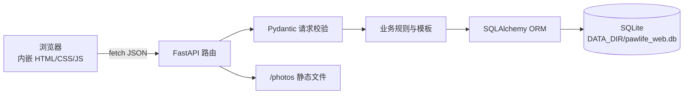
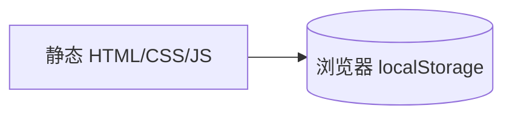
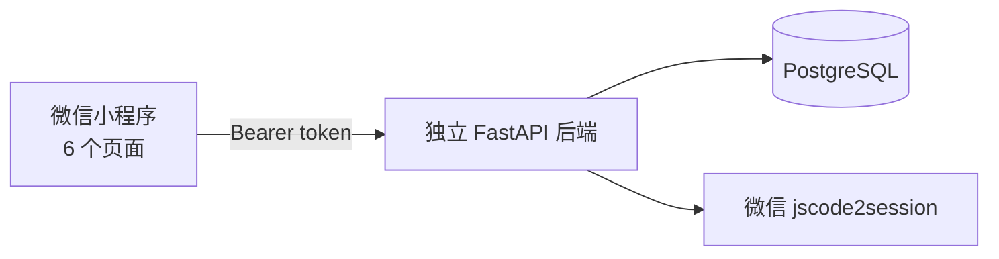

# PawLife 技术细节

> **文档基线**：commit `7faa5b1`，2026-11-16
> **主要对象**：`pawlife_web.py`（11,380 行，单文件 Web 应用）
> **相关文档**：[README](../README.md) · [审计报告](AUDIT.md)
> **说明**：本文记录当前代码实际采用的规则和实现方式，不代表这些规则已经过临床验证。

---

## 1. 范围与术语

本文主要说明原始 Web 应用；`showcase/` 和 `miniprogram/` 作为独立部分单独说明。

| 术语 | 含义 |
| --- | --- |
| 原始 Web 应用 | `pawlife_web.py` 提供的 FastAPI + SQLite 单文件应用 |
| Showcase | `showcase/` 下的纯静态展示版，使用浏览器演示数据 |
| 小程序 | `miniprogram/` 下的微信小程序前端及其独立后端 |
| 规则引擎 | 代码中的 Python 条件判断、公式和数据表，不是大模型推理 |
| 高风险事件 | 带有 `high_risk=1` 标记的事件，会暂停当天饮食和保健品建议 |

---

## 2. 运行架构与数据流

### 2.1 Web 应用

- `GET /` 返回完整的单页 HTML；首页和 6 个子页面通过显示/隐藏 DOM 切换。
- 前端使用原生 `fetch` 调用同源 `/api/*`，无前端构建步骤。
- 启动时 `init_db()` 建表并执行增量列迁移，`create_demo_data()` 在缺少「曦曦」演示狗时创建演示档案。
- CORS 默认不开放跨域（`ALLOWED_ORIGINS` 为空）；需要通过环境变量显式配置来源白名单。Web 端仍没有认证或用户隔离。
- 页面还从 `fonts.googleapis.com` / `fonts.gstatic.com` 加载 Google Fonts，这是当前 Web 页面的外部资源请求。

### 2.2 Showcase

- 7 个页面：首页、成长日记、伙食搭配、高光时刻、元气补给、身材管理、贴心闹钟。
- 使用 hash 路由（如 `#/diet`），数据保存在 `pawlife.showcase.v2`，不调用后端 API。
- 业务规则由 `showcase/js/data.js` 等文件用 JavaScript 重新实现，和原始 Python 代码不是同一套运行时。

### 2.3 小程序

- 用户以 `users.openid` 标识，狗狗以 `dogs.owner_id` 做数据隔离。
- 与 Web 应用不共享数据库、用户或业务数据。

---

## 3. 数据模型

Web 应用有 8 个 SQLAlchemy 模型，对应 8 张表。表之间通过应用层的 `dog_id` / `pet_id` 关联，模型中未声明数据库外键。

| 表 | 关键字段 | 用途 |
| --- | --- | --- |
| `dogs` | `id`, `name`, `breed`, `birthday`, `weight`, `neutered`, `allergies`, `gender`, `photo`, `bath_interval_days`, `last_bath_date`, `diseases`, `suspended_until`, `badges`, `paw_points`, `photos`, `today_avatar_index`, `avatar_date`, `avatar_unlocked`, `home_date`, `health_photos`, `created_at` | 单只狗狗档案及派生状态 |
| `events` | `id`, `dog_id`, `type`, `date`, `detail`(JSON 文本), `high_risk`, `risk_keyword`, `photo`, `created_at` | 疫苗、驱虫、发情、异常、洗澡、每日检查 |
| `weight_logs` | `id`, `dog_id`, `weight`, `date`, `created_at` | 体重历史 |
| `bcs_logs` | `id`, `dog_id`, `bcs_state`, `date`, `created_at` | BCS 体况历史 |
| `supplement_alerts` | `id`, `dog_id`, `supplement_name`, `reason`, `woof_text`, `priority`, `is_active`, `created_at` | 当前保健品推荐快照 |
| `risk_logs` | `id`, `dog_id`, `input_text`, `matched_keyword`, `action_taken`, `warning_shown`, `user_confirmed`, `created_at` | 高风险事件日志 |
| `paw_points_logs` | `id`, `pet_id`, `amount`, `reason`, `created_at` | 爪印积分流水 |
| `checkins` | `id`, `pet_id`, `check_date`, `streak`, `task_completed`, `created_at` | 签到与任务完成状态 |

`detail`、`badges`、`photos`、`health_photos` 以 JSON 文本存储在 `TEXT` 字段中。时间字段由 Python 的 `datetime.utcnow` 默认值生成；部分业务日期使用服务器本地日期 `date.today()`。

---

## 4. API 端点

当前 `pawlife_web.py` 有 **37 个 HTTP 路由**（包括根路由 `/`，不包括 `/photos` 静态挂载）。按用途分组如下。

### 4.1 档案与饮食

| 方法 | 路径 | 说明 |
| --- | --- | --- |
| GET | `/api/dog` | 获取最新创建的狗狗档案 |
| POST | `/api/dog` | 创建档案，可同步首条体重记录 |
| PUT | `/api/dog` | 更新最新档案，体重变化时追加体重记录 |
| POST | `/api/dog/unsuspend` | 解除高风险暂停 |
| GET | `/api/dog/diet` | 返回一餐食谱、RER/DER 和营养换算 |

### 4.2 图片

| 方法 | 路径 | 说明 |
| --- | --- | --- |
| POST | `/api/dog/photo` | 上传档案照片（JPG/PNG，≤2 MB） |
| POST | `/api/dog/health_photo` | 上传健康成长照片，可关联事件 |
| DELETE | `/api/dog/health_photo` | 删除健康照片 |
| POST | `/api/records/{record_id}/photo` | 为事件上传照片 |
| POST | `/api/pets/{pet_id}/photos` | 上传头像盲盒照片（Base64，最多 6 张） |
| DELETE | `/api/pets/{pet_id}/photos` | 删除头像盲盒照片 |

### 4.3 事件、体重与体况

| 方法 | 路径 | 说明 |
| --- | --- | --- |
| POST | `/api/event` | 创建事件，含幂等键和高风险标记 |
| PUT | `/api/event/{event_id}` | 编辑事件类型、日期和详情 |
| DELETE | `/api/event/{event_id}` | 删除事件及关联照片文件 |
| GET | `/api/events` | 获取当前狗狗全部事件 |
| GET | `/api/weight_logs` | 获取体重记录 |
| POST | `/api/weight_log` | 新增体重记录并同步档案体重 |
| DELETE | `/api/weight_log/{log_id}` | 删除体重记录并重新同步 |
| POST | `/api/bcs` | 记录 BCS（thin/ideal/heavy） |
| GET | `/api/bcs` | 获取 BCS 历史与最新状态 |

### 4.4 保健品、提醒和工具

| 方法 | 路径 | 说明 |
| --- | --- | --- |
| GET | `/api/supplements` | 计算并返回活跃保健品提醒 |
| GET | `/api/health_check` | 汇总提醒、最新事件、暂停状态和提醒参数（含 `vaccine_reminder_days`） |
| GET | `/api/vet_summary/{event_id}` | 为异常行为生成兽医摘要数据 |
| GET | `/api/export` | 导出档案、事件、体重的 CSV |
| GET | `/api/daily_tip` | 加权随机返回每日提示 |
| GET | `/api/quiz` | 返回当日测验题和答案字段 |

### 4.5 游戏化

| 方法 | 路径 | 说明 |
| --- | --- | --- |
| GET | `/api/badges` | 返回 16 枚勋章及解锁状态 |
| POST | `/api/quiz/complete` | 答对测验奖励爪印（每天限一次） |
| GET | `/api/task` | 返回当日确定性任务 |
| POST | `/api/task/complete` | 完成任务，必要时自动补签 |
| GET | `/api/checkin/status` | 签到、连续天数和任务状态 |
| POST | `/api/checkin` | 执行每日签到 |
| GET | `/api/daily_check` | 查询今日健康检查 |
| POST | `/api/daily_check` | 记录今日健康检查 |

### 4.6 头像、爪印与首页

| 方法 | 路径 | 说明 |
| --- | --- | --- |
| GET | `/api/pets/{pet_id}/avatar` | 计算今日头像 |
| GET | `/api/pets/{pet_id}/paw-history` | 获取爪印历史 |
| GET | `/` | 返回完整单页 HTML |

### 4.7 错误与幂等行为

- 未捕获异常返回 HTTP 500，响应体为 `{"message": "..."}`；
- 404 处理器返回 HTTP 404，响应体为 `{"message": "..."}`；
- 业务校验使用 `HTTPException`，默认响应体为 `{"detail": "..."}`；
- 因此错误响应格式并不完全统一，前端 `api()` 同时兼容 `message` 和 `detail`；
- 事件幂等键命中时返回 HTTP 200 和 `{"duplicate": true, "message": ...}`，不是 409。幂等缓存由进程内 `FakeRedis` 保存，默认 5 分钟。

---

## 5. 核心规则

### 5.1 年龄、体型和洗澡间隔

**年龄阶段**（`_get_age_stage`）：

- `age_months <= 12`：幼犬；
- 老年阈值：巨型犬 72 个月、大型犬 78 个月、其他犬种 84 个月；
- 未达到老年阈值时为成犬，达到后为老年犬。

**体型**（`_get_body_size`）：

- `< 5 kg`：小型犬；
- `5–15 kg`：中型犬；
- `>= 15 kg`：大型犬。

**洗澡间隔**（`_calc_bath_interval`）：

- 无体重或无法解析：基准 10 天；
- 体重 `< 15 kg`：基准 14 天；
- 体重 `>= 15 kg`：基准 10 天；
- 短鼻犬种（法斗、英斗、巴哥、京巴、西施）：`max(7, 基准 - 4)`；
- 双层被毛犬种（哈士奇、萨摩耶、阿拉斯加、秋田、松狮、银狐、柴犬、金毛、边牧、德牧、博美）：`min(30, 基准 + 10)`。

该间隔在创建/更新档案时写入 `bath_interval_days`；创建、编辑或删除洗澡事件会重算 `last_bath_date`。

### 5.2 饮食与能量计算

**RER**（`_calc_rer`）：

- 体重 `2 <= w <= 45 kg`：`RER = 30 * w + 70`；
- 其他体重：`RER = 70 * w ** 0.75`。

**DER**（`_calc_daily_grams`）：

- 幼犬系数 `2.5`；
- 已绝育系数 `1.6`；
- 未绝育系数 `1.8`；
- 性别系数：公犬 `1.1`，母犬 `1.0`；
- `DER = RER * 阶段系数 * 性别系数`；
- 每日总克数 `total_g = round(DER / 1.5)`，其中 1.5 kcal/g 是代码中的估算常数；
- 每日总克数按蛋白质 55%、碳水 25%、蔬菜 15% 分配；
- 每餐克数 = 各宏量克数 / 餐数。

**食谱表**（`DIET_FOODS`）包含 9 组组合：

| 年龄阶段 | 体型 | 餐数/天 | 基础蛋白 | 基础蔬菜 | 基础碳水 |
| --- | --- | --- | --- | --- | --- |
| 幼犬 | 小型犬 | 4 | 鸡胸肉 | 南瓜 | 燕麦 |
| 幼犬 | 中型犬 | 3 | 牛肉糜 | 胡萝卜 | 糙米 |
| 幼犬 | 大型犬 | 3 | 鸡胸肉 | 菠菜 | 红薯 |
| 成犬 | 小型犬 | 2 | 鱼肉 | 西兰花 | 红薯 |
| 成犬 | 中型犬 | 2 | 牛肉 | 西兰花 | 红薯 |
| 成犬 | 大型犬 | 2 | 牛肉 | 胡萝卜 | 糙米 |
| 老年犬 | 小型犬 | 2 | 鱼肉 | 菠菜 | 南瓜 |
| 老年犬 | 中型犬 | 2 | 鱼肉 | 菠菜 | 糙米 |
| 老年犬 | 大型犬 | 2 | 鱼肉 | 菠菜 | 糙米 |

食材营养值来自 `FOOD_NUTRITION`（每 100 g 的蛋白质、脂肪、碳水），页面按实际克数换算并汇总。大型幼犬的提示文字提到钙磷比和蛋壳粉，但代码 **没有计算钙、磷或钙磷比**；该提示是文本建议，不是计算结果。

**过敏过滤**：

- 过敏源按中文逗号/英文逗号分割；
- `ALLERGY_FOOD_MAP` 将常见过敏关键词映射到食材；
- 未命中映射时，用过敏关键词对食材名做包含匹配；
- 蛋白、蔬菜、碳水分别替换；如果全部候选都被排除，回退到该类别的第一个候选（极端情况下可能仍不适合）。
- 替换选项也会过滤，鱼过敏时会跳过含“鱼油”的保健品。

**暂停**：如果 `dogs.suspended_until > datetime.utcnow()`，饮食接口返回 `ready: false, suspended: true`，不生成食谱。

### 5.3 保健品规则

`SUPPLEMENT_RULES` 有 **13 条基础规则**，由品种、年龄、体重、性别、绝育状态和异常行为统计触发：

| ID | 触发条件摘要 | 合并方向 |
| --- | --- | --- |
| `joint_large_breed` | 大型犬品种且 ≥6 个月 | 关节保护 |
| `joint_senior` | 老年犬 | 关节保护 + 抗氧化 |
| `joint_long_body` | 柯基/法斗/英斗/京巴/西施且 ≥12 个月 | 关节保护 |
| `joint_heavy` | 体重 ≥30 kg 且 ≥12 个月 | 关节保护 |
| `multi_vitamin_puppy` | 幼犬 | 综合维生素 |
| `omega3_itchy` | 异常行为中抓痒记录 ≥2 次 | Omega-3 鱼油 |
| `probiotics_digest` | 呕吐或腹泻记录 ≥1 次 | 益生菌 |
| `beauty_curly` | 贵宾/泰迪/比熊/马尔济斯/迷你雪纳瑞/约克夏且 ≥6 个月 | 美毛 |
| `urinary_female_unneutered` | 未绝育母犬且 ≥36 个月 | 蔓越莓 |
| `prostate_male_unneutered` | 未绝育公犬且 ≥36 个月 | 南瓜籽 |
| `skin_sensitive_breed` | 法斗/英斗/巴哥/京巴/西施且 ≥6 个月 | 皮肤养护 |
| `eye_care_breed` | 巴哥/京巴/西施/比熊/马尔济斯且 ≥12 个月 | 眼部护理 |
| `heart_large_breed` | 杜宾/金毛/拉布拉多/德牧/大丹且 ≥24 个月 | 心脏保健 |

附加逻辑：

- **病史关键词**：关节、心脏、皮肤/过敏、胰腺、眼部五类关键词会追加或合并保健品建议；
- **季节优先级**：6–8 月和 12–2 月会调整关节、皮肤、综合维生素的优先级；
- **去重**：`SUPPLEMENT_MERGE_KEYS` 将同类保健品合并，保留最高优先级和最相关话术；
- **过敏**：鱼过敏会跳过含“鱼油”的推荐，并给出藻油/亚麻籽油替代提示；
- **暂停**：高风险暂停期间 `/api/supplements` 返回暂停状态。

这些规则是项目内的启发式建议，没有剂量计算，也没有经过临床验证。

### 5.4 事件、风险和高风险流程

**事件类型**：疫苗、驱虫、发情、异常行为、洗澡澡、每日检查。

**校验**：

- `type` 必须属于 `EVENT_TYPES`；
- `date` 不能晚于今天，也不能早于 2000-01-01；
- 发情事件只允许母犬；
- 照片最多 2 MB，类型为 JPG/PNG；
- `idem_key` 相同且在缓存有效期内时，返回重复响应。

**事件反应**：不同事件类型由 `generate_*_reaction` 生成狗狗第一人称文本；异常行为会调用 `analyze_behavior`，按品种 + 症状匹配决策树（11 个品种 + 默认分支）。

**高风险流程**：

1. 异常行为表单提供症状多选和补充描述；
2. 前端把两者合并扫描 `HIGH_RISK_SYMPTOMS` 和 22 条 `HIGH_RISK_SYNONYMS`；
3. 服务端在创建/编辑异常行为时使用同一套词表再次扫描，不依赖前端是否传 `high_risk`；
4. 扫描会跳过“没有/未见/无明显”等否定表达，以及“上次已恢复/昨天便血今天正常”等明确历史且已恢复的描述；同一文本中后续未否定的风险词仍会命中；
5. 命中后写入 `events.high_risk` / `risk_keyword` 和 `risk_logs`；
6. `dogs.suspended_until` 设置为 UTC 当天 23:59:59；
7. 饮食和保健品接口在截止前返回暂停状态；
8. `POST /api/dog/unsuspend` 可手动恢复；之后编辑普通事件不会重新暂停。

**编辑/删除派生状态**：

- 编辑事件会重新扫描风险并更新 `high_risk` / `risk_keyword`；
- 编辑或删除洗澡事件会重算 `dogs.last_bath_date`；
- 删除事件会移除 `health_photos` 中对应照片引用并重算风险暂停；
- 编辑事件会同步健康相册中的事件类型和日期；改为异常行为时移除相册条目；
- 多条高风险事件并存时，删除/编辑其中一条会按剩余高风险事件重算暂停；删除最后一条才清除；
- `risk_logs` 作为历史审计记录保留，不随事件编辑/删除重写；风险暂停状态由当前高风险事件重算；
- 勋章和爪印按成就记录保留，不因删除事件回滚。

**风险边界**：关键词提示不是诊断，不覆盖所有急症；普通症状不会自动升级为高风险。

### 5.5 照护提醒

提醒由前端提醒页和后端 `health_check` 分别计算；疫苗提醒参数已由后端统一，其他提醒仍由两端分别生成：

| 提醒 | 前端提醒页 | 后端 `health_check` |
| --- | --- | --- |
| 疫苗 | 读取 `/api/health_check` 的 `vaccine_reminder_days`；≤0 逾期，≤30 天预警 | 最近一次 + `VACCINE_REMINDER_DAYS`（默认 1095 天）；≤60 天提醒 |
| 驱虫 | 幼犬（<6 月）30 天，其余 90 天；≤0 逾期，≤14 天预警 | 幼犬 30 天，其余 90 天；≤14 天提醒 |
| 发情 | 使用 `_cachedDog.gender === 'female'`，与 API 枚举一致 | 未绝育母犬（`female`）+ 180 天，≤21 天提醒 |
| 洗澡 | 从 `/api/health_check` 获取 | 按 `bath_interval_days` 和 `last_bath_date` 计算 |
| 保健品 | 从 `/api/health_check` 获取一条 | 从活跃推荐中随机选一条 |
| BCS | 从 `/api/health_check` 获取 | 无记录提醒；偏瘦/偏胖 14 天，理想 30 天 |
| 体重 | 幼犬 10 天、成犬 35 天未记录则提示 | 不计算 |
| 每日检查 | 查询 `/api/daily_check` 后提示 | 不计算 |

疫苗周期现在由后端统一返回 `vaccine_reminder_days`，前端只展示；该值是项目提醒参数，不是医学标准。

**每日提示数据源**：首页“今日养宠提示”调用 `/api/daily_tip`，使用后端 `SURVIVAL_TIPS` 的 55 条加权提示；原先未使用的 89 条前端提示数组已移除，避免两套内容继续漂移。

### 5.6 签到、任务、勋章和测验

- **签到**：每天一次，`/api/checkin` +1 爪印；连续天数由 `checkins.streak` 维护；
- **任务**：`DAILY_TASKS` 17 条，`/api/task/complete` +2 爪印；若当天未签到会自动补签；高光时刻页有任务卡入口；
- **签到里程碑**：7/14/30/60 天分别追加“忠实爪印/黄金骨头/汪汪守护神/传说铲屎官”字符串；
- **勋章**：`BADGE_DEFINITIONS` 16 枚，分“第一次/守护者/健康里程碑”三组，解锁条件由 `check_badges` 计算；
- **爪印**：签到 +1、任务 +2、答对测验 +2、记录事件 +1（有幂等键时）；
- **测验**：`QUIZZES` 10 道题，`/api/quiz` 返回题目和 `answer` 字段；答对后 `/api/quiz/complete` +2，每天限一次。

签到时写入的里程碑字符串不在 `BADGE_DEFINITIONS` 中，`/api/badges` 的 `total_unlocked` 会把它计入数量，但勋章墙只遍历 16 个定义，因此可能出现“计数包含但墙上不显示”的差异。见 [AUDIT A10](AUDIT.md#a10)。

### 5.7 照片与导出

- 档案照片、事件照片、健康照片使用 `PHOTOS_DIR` 保存，文件名为 UUID；
- 上传限制：JPG/PNG，最大 2 MB；
- 健康事件照片会追加到 `dogs.health_photos`（异常行为照片除外）；编辑事件会同步相册元数据，删除事件会移除引用；
- 首页健康成长相册展示 `health_photos`，点击照片可删除；头像盲盒照片以 Base64 存在 `dogs.photos`，最多 6 张；`GET /api/pets/{id}/avatar` 会从健康照片、档案照片和盲盒中选今日头像。盲盒上传/删除接口存在，但当前内嵌页面仍未接入完整的盲盒管理入口；
- CSV 导出只包含狗狗档案、事件和体重记录；不包含 BCS、签到、爪印历史或照片文件。

---

## 6. 数据持久化与迁移

- 默认数据库：`DATA_DIR/pawlife_web.db`，`DATA_DIR` 未设置时为项目根目录；
- 照片目录：`DATA_DIR/photos/`；
- 启动时 `Base.metadata.create_all()` 建表，然后通过 `PRAGMA table_info` 检测并添加新列；
- 没有版本化迁移工具或回滚脚本；
- 模型没有数据库外键，删除狗狗时不会自动级联删除其他表记录；
- `create_demo_data()` 在没有「曦曦」时创建演示狗和一条疫苗事件；
- `FakeRedis` 是进程内字典，重启或多进程部署后幂等缓存不共享。

---

## 7. Showcase 实现

- 入口：`showcase/index.html`；
- 页面：`home`、`record`、`diet`、`badges`、`supplement`、`weight`、`reminders`；
- 路由：hash 路由，带旧路由别名（`dashboard`、`nutrition`、`records`、`trends`、`growth` 等）；
- 数据：`showcase/js/data.js` 中的「团团」演示数据和 `localStorage` 键 `pawlife.showcase.v2`；
- 规则：RER/DER、过敏过滤、保健品、提醒和勋章的 JavaScript 移植；
- 差异：Showcase 有 30 天体重范围和 JSON 演示导出；原始 Web 的体重范围是 90/180/365 天，导出为 CSV。Showcase 没有真实照片上传、SQLite 持久化和兽医摘要；它是独立静态演示，不是原始应用的生产前端。

---

## 8. 小程序实现

- 页面：`pages/index`、`record`、`profile`、`timeline`、`diet`、`supplement`；
- 后端：`miniprogram/pawlife_backend.py`，FastAPI + PostgreSQL；
- 认证：`/api/login` 用微信 `jscode2session` 换 `openid`，未配置 AppID/Secret 时使用开发模式；
- 数据隔离：`dogs.owner_id` 关联 `users.openid`；
- 接口：17 个，覆盖档案、事件、时间线、饮食、保健品、健康检查、体重、导出、兽医摘要和照片；
- 状态：需要单独配置 `DATABASE_URL`、`WX_APPID`、`WX_SECRET`、小程序 `baseUrl` 和 PostgreSQL 驱动；仓库未提供独立依赖文件，未完成端到端验证。

---

## 9. 规则来源与验证边界

| 规则 | 当前实现 | 来源与验证状态 |
| --- | --- | --- |
| RER 双公式 | `30w+70`（2–45 kg），否则 `70w^0.75` | 代码实现；仓库未附文献引用。早期兽医审查材料曾与 NRC 2006 对照，但该材料基于旧版本 |
| DER 系数 | 幼犬 2.5、绝育 1.6、未绝育 1.8；公犬 ×1.1 | 项目参数；未见仓库内的验证记录 |
| 能量密度 | 1.5 kcal/g | 代码注释中的估算常数；未提供出处 |
| 宏量配比 | 蛋白 55%、碳水 25%、蔬菜 15% | 项目食谱配比，不是商业狗粮标准 |
| 食材营养表 | 每 100 g 的蛋白/脂肪/碳水 | 项目内置数据；未附逐项来源 |
| 保健品 | 13 条基础规则 + 病史/季节附加 | 启发式规则；没有剂量指导，不能替代兽医 |
| 疫苗提醒 | 后端 `VACCINE_REMINDER_DAYS`（默认 1095 天），前端读取该值 | 项目提醒参数；不是统一医学标准 |
| 高风险词 | 31 个关键词 | 关键词拦截规则；不构成诊断，也不覆盖所有急症 |
| 品种决策树 | 11 个品种 + 默认 | 项目内置建议文本；未经过临床验证 |

结论：这些规则适合做产品原型和记录辅助，不应被描述为临床验证过的医学结论。任何健康决策应由执业兽医确认。

---

## 10. 相关审计

当前确认问题、已修正的文档错误、未验证事项和建议优先级见 [AUDIT.md](AUDIT.md)。本文只描述实现，不把历史审计文档中的旧数字当作当前事实。
